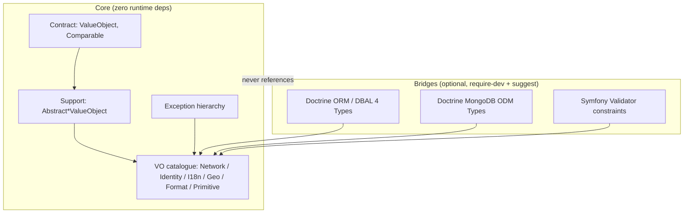
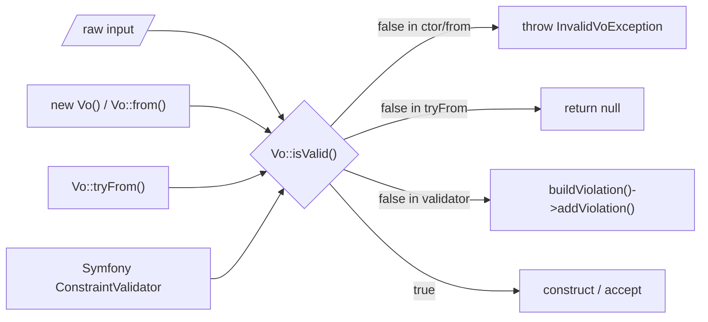

# feat: Value Objects library for PHP 8.4+ with Doctrine and Symfony bridges

## Summary

Build `msstc4php/value-objects` — a dependency-free library of immutable Value
Objects for PHP 8.4+. Each VO is `final readonly`, validates in its constructor
(fail-fast, typed exception), and exposes a single validation rule reused by
optional framework bridges. Bridges for Doctrine ORM, Doctrine MongoDB ODM, and
Symfony Validator ship in the same package but are autoload-isolated behind
`suggest` + `require-dev`, so the core installs and runs with zero framework
dependencies.

---

## Problem Frame

VO primitives (email, IP, UUID, currency, geo-coordinates…) are re-implemented
per project with divergent validation, no shared contract, and no ready
persistence or validation glue. This library is the single source of truth for
base domain primitives: standalone in plain PHP, and drop-in compatible with
Doctrine ORM/ODM (custom Types) and Symfony Validator (Constraint + Validator)
when those are present (see origin: `docs/brainstorms/2026-07-03-php-value-objects-library-requirements.md`).

---

## Requirements

### Core contract

- R1. Every VO is a `final readonly class` implementing a `ValueObject`
  contract (`equals(self): bool`, `jsonSerialize()`, `__toString()` where a
  string form is meaningful); no partially-valid state exists after construction.
- R2. The constructor validates and throws a typed exception derived from a
  common `InvalidValueObjectException` (e.g. `InvalidIpv4Exception`) with a clear
  message; validation is fail-fast (first violation).
- R3. One validation rule per VO: a static `isValid(mixed): bool` and
  `tryFrom(mixed): ?static`; constructor, `tryFrom`, and the Symfony validator
  all delegate to it — no duplicated regex/logic.
- R4. Named constructor convention `from()` / `tryFrom()` mirroring
  `BackedEnum`, plus type-specific factories (`Uuid::v4()`, `IpAddress::fromString()`).
- R5. Reusable constrained base classes (`AbstractStringValueObject`,
  `AbstractIntValueObject`, `AbstractFloatValueObject`) let a concrete VO declare
  its rule via override hooks rather than re-implement plumbing.

### VO catalogue (v1)

- R6. Network: `Ipv4Address`, `Ipv6Address`, `IpAddress`, `MacAddress`,
  `Hostname`, `DomainName`, `Port`, `UrlScheme`, `UrlPath`, `Uri`, `Url`.
- R7. Identity: `Uuid` (validate + version detect v1/v3/v4/v5/v6/v7,
  generate v4/v7), `EmailAddress` (syntax only; no DNS).
- R8. i18n / geo: `CountryCode`, `LanguageCode`, `CurrencyCode` (backed enums),
  `Locale` (BCP 47), `Latitude`, `Longitude`, `GeoCoordinates`.
- R9. Base primitives: `NonEmptyString`, `BoundedString`, `PositiveInt`,
  `NonNegativeInt`, `IntRange`, `Percentage`, `HexColor`, `Slug`,
  `Base64String`, `JsonString`, `PhoneNumber` (E.164), plus `SemVer` and
  `ClassString` (added from prior-art survey; `ClassString` matches the
  project's strict `class-string<T>` discipline).

### Framework bridges

- R10. Doctrine ORM: a custom DBAL `Type` per scalar VO (stored as
  `VARCHAR`/`INT`); `GeoCoordinates` mapped as an `#[ORM\Embeddable]` (one
  column per field). A bootstrap helper registers Types for bare Doctrine.
- R11. Doctrine MongoDB ODM: an analogous ODM `Type` per VO; multi-field VOs
  serialize to an embedded BSON sub-document.
- R12. Symfony Validator: a generic `ValidValueObject` constraint plus per-VO
  thin constraints, each validator delegating to the VO's `isValid()` (R3);
  validators are constructor-argument-free so they work under
  `Validation::createValidator()` without a container.
- R13. Bridges load only when their framework is installed; the core never
  references a bridge class (one-way dependency bridge → core).

### Quality

- R14. Full unit coverage per VO (valid/invalid/boundary inputs, `equals`,
  serialization) plus Doctrine Type round-trip tests and VO↔Constraint parity
  tests; PHPStan at max with strict typing per project rules.

---

## Key Technical Decisions

- KTD1. **Single package, dependency-free core, optional bridges.** `doctrine/dbal`,
  `doctrine/orm`, `doctrine/mongodb-odm`, `symfony/validator`, `brick/money` go in
  `require-dev` + `suggest`, never `require`. Matches ramsey/uuid, brick/*.
  (origin D1)
- KTD2. **Autoload safety via strict one-way dependency.** Bridge classes
  `extends` framework base classes, so they fatal if autoloaded without the
  framework. Safe only because the core never references a bridge (no `use`, no
  FQCN string, no auto-registration); bridges are reached solely from consumer
  bootstrap after `composer require doctrine/*`. This constraint is enforced in
  tooling (deptrac/phpat layer rule).
- KTD3. **Immutability shape.** `final readonly class`; explicit-nullable
  params (`?T $x = null`) — implicit-nullable is deprecated in 8.4. `readonly`
  and property hooks are mutually exclusive per property: use `readonly` for
  stored state, hooks only for derived read-only accessors (e.g.
  `EmailAddress::$domain`). (origin D4)
- KTD4. **Single validation source.** Rule lives in the VO's static
  `isValid()`/`tryFrom()`; constructor and Symfony validator delegate to it.
  (origin D2)
- KTD5. **Fail-fast typed exceptions.** Per-VO exception extends
  `InvalidValueObjectException` (itself extends `\InvalidArgumentException`);
  first violation throws. No violation-collecting path in v1.
- KTD6. **Constrained base classes.** `AbstractStringValueObject` /
  `AbstractIntValueObject` / `AbstractFloatValueObject` centralize equality,
  serialization, and the `from`/`tryFrom`/`isValid` skeleton; subclasses
  override rule hooks (`pattern()`, `minLength()`, bounds). Idea adopted from
  slepic/php-value-object.
- KTD7. **ISO sets as backed enums, generated but shipped static.** `CountryCode`,
  `LanguageCode`, `CurrencyCode` are `string`-backed enums generated at dev-time
  from `symfony/intl` via a `tools/` script; the generated PHP is committed, so
  there is no runtime dependency on `symfony/intl`. (origin D3)
- KTD8. **Uuid is self-contained.** Validation + version parsing + v4/v7
  generation use `random_bytes` only — no `ramsey/uuid` or `symfony/uid`
  runtime dependency. (resolves origin deferred question)
- KTD9. **Doctrine ORM bridge on DBAL 4.** `getName()` and
  `requiresSQLCommentHint()` are removed in DBAL 4 — do not implement them; Type
  identity is the registered name string. An abstract base Type centralizes
  null-handling + convert plumbing; a thin concrete Type per scalar VO supplies
  the SQL declaration. Register via `Type::addType()` (bare Doctrine helper) or
  `doctrine.dbal.types` (documented Symfony snippet).
- KTD10. **ODM bridge is separate from ORM.** ODM's `Type` base has no
  `$platform` argument and no `getSQLDeclaration`, and needs the `ClosureToPHP`
  trait — a distinct implementation, not a shared one with ORM.
- KTD11. **Money stays out of core.** Core ships only `CurrencyCode`. Full
  money (amount + arithmetic) is `brick/money`'s job; a `brick/money` Doctrine
  bridge is deferred follow-up. (origin D6)

---

## High-Level Technical Design

### Package layering and dependency direction



Bridges depend on core; core never depends on a bridge (KTD2). The dotted edge
is a forbidden direction enforced by the layer-rule tool.

### Single validation source



All entry points funnel through one predicate (R3, KTD4), so VO and Validator
verdicts can never diverge.

---

## Output Structure

```text
composer.json
phpstan.neon.dist
.php-cs-fixer.dist.php
rector.php
phpunit.xml.dist
deptrac.yaml
Makefile
tools/
  generate-iso-enums.php
src/
  Contract/            ValueObject.php  Comparable.php
  Exception/           InvalidValueObjectException.php  Invalid<Type>Exception.php…
  Support/             AbstractStringValueObject.php  AbstractIntValueObject.php  AbstractFloatValueObject.php
  Primitive/           NonEmptyString.php  BoundedString.php  PositiveInt.php  NonNegativeInt.php  IntRange.php  Percentage.php
  Network/             Ipv4Address.php  Ipv6Address.php  IpAddress.php  MacAddress.php
                       Hostname.php  DomainName.php  Port.php  UrlScheme.php  UrlPath.php  Uri.php  Url.php
  Identity/            EmailAddress.php  Uuid.php
  I18n/                CountryCode.php  LanguageCode.php  CurrencyCode.php  Locale.php
  Geo/                 Latitude.php  Longitude.php  GeoCoordinates.php
  Format/              Slug.php  HexColor.php  Base64String.php  JsonString.php  PhoneNumber.php  SemVer.php  ClassString.php
  Bridge/
    Doctrine/Orm/      AbstractStringVoType.php  AbstractIntVoType.php  <Vo>Type.php…  GeoCoordinates embeddable  TypeRegistrar.php
    Doctrine/Odm/      AbstractStringVoType.php  <Vo>Type.php…
    Symfony/Validator/ ValidValueObject.php  ValidValueObjectValidator.php  <Vo>/…Constraint.php + …Validator.php
tests/                 mirrors src/ (Unit/, Bridge/)
.claude/docs/          README.md  architecture.md  domain-model.md  integrations.md  conventions.md  known-issues.md
.github/workflows/     ci.yml
```

PSR-4: `MSSTC4PHP\ValueObject\` → `src/`, `MSSTC4PHP\ValueObject\Tests\` → `tests/`.
The tree is a scope declaration; per-unit `Files` are authoritative.

---

## Implementation Units

Grouped into four phases. Units are dependency-ordered; U-IDs are stable.

### Phase 1 — Foundation

### U1. Package scaffolding and tooling

**Goal:** Composer package, autoloading, and the full quality toolchain.
**Requirements:** R1, R14, KTD1, KTD2.
**Dependencies:** none.
**Files:** `composer.json`, `phpstan.neon.dist`, `.php-cs-fixer.dist.php`,
`rector.php`, `phpunit.xml.dist`, `deptrac.yaml`, `Makefile`, `.gitignore`.
**Approach:** `require: php >=8.4`. `require-dev` + `suggest`:
`doctrine/dbal`, `doctrine/orm`, `doctrine/mongodb-odm`, `symfony/validator`,
`symfony/intl`, `brick/money`. PSR-4 roots per Output Structure. PHPStan max
(strict). `deptrac.yaml` encodes the layer rule: `Core` must not depend on
`Bridge` (KTD2); `Bridge` may depend on `Core`.
**Patterns to follow:** ramsey/uuid, brick/math `composer.json` shape (core
deps empty, integrations in suggest).
**Test scenarios:** none — scaffolding. Verify `composer validate` passes and
`make check` runs the empty suite green.
**Verification:** `composer install` with `--no-dev` pulls zero packages beyond
PHP; `make check` (phpstan + cs-fixer + rector + phpunit) is green.

### U2. Core contracts, abstract bases, exception hierarchy

**Goal:** The shared contract and the constrained-base machinery every VO uses.
**Requirements:** R1, R2, R3, R4, R5, KTD3, KTD4, KTD5, KTD6.
**Dependencies:** U1.
**Files:** `src/Contract/ValueObject.php`, `src/Contract/Comparable.php`,
`src/Exception/InvalidValueObjectException.php`,
`src/Support/AbstractStringValueObject.php`,
`src/Support/AbstractIntValueObject.php`,
`src/Support/AbstractFloatValueObject.php`;
tests `tests/Unit/Support/AbstractStringValueObjectTest.php`,
`tests/Unit/Support/AbstractIntValueObjectTest.php`.
**Approach:** `ValueObject` declares `equals(self): bool` and `jsonSerialize()`.
`Comparable` adds `compareTo(self): int` for ordered VOs (numeric, `SemVer`).
Abstract bases implement `from`/`tryFrom`/`isValid`/`equals`/`__toString`/
`jsonSerialize` once; subclasses override protected rule hooks
(`normalize()`, `validate()` throwing the VO's typed exception, or
`pattern()`/bounds for the constrained variants). `InvalidValueObjectException
extends \InvalidArgumentException`.
**Execution note:** Implement the abstract bases test-first — they are the
contract the whole catalogue leans on.
**Patterns to follow:** slepic constrained-base hooks (KTD6); `BackedEnum`
`from`/`tryFrom` semantics.
**Test scenarios:**
- A minimal string VO subclass: `from()` on valid input constructs; on invalid
  throws its typed exception; `tryFrom()` returns null on invalid.
- `equals()` true for same value, false for different value and different type.
- `jsonSerialize()`/`__toString()` return the underlying scalar.
- Constrained int base: value below/above bound throws; at bound constructs.
- `Comparable::compareTo` returns <0/0/>0 for ordered numeric values.
**Verification:** PHPStan max clean; base-behavior tests green; no bridge
reference exists in `src/` (deptrac green).

### Phase 2 — VO catalogue

### U3. Base primitives

**Goal:** Numeric and string primitives that exercise the abstract bases.
**Requirements:** R9 (`NonEmptyString`, `BoundedString`, `PositiveInt`,
`NonNegativeInt`, `IntRange`, `Percentage`).
**Dependencies:** U2.
**Files:** `src/Primitive/*.php` for the six VOs; per-VO exception classes in
`src/Exception/`; `tests/Unit/Primitive/*Test.php`.
**Approach:** Each subclasses the matching abstract base and declares only its
rule. `Percentage` is a bounded float `0..100`; `IntRange` holds two ints with
`min <= max` invariant and derived `contains(int): bool`.
**Patterns to follow:** U2 abstract bases.
**Test scenarios:**
- `NonEmptyString`: empty string and whitespace-only throw; non-empty constructs.
- `BoundedString`: below min / above max throw; boundary lengths construct;
  multibyte length counted correctly.
- `PositiveInt`: 0 and negatives throw; `1` constructs. `NonNegativeInt`: `-1`
  throws, `0` constructs.
- `IntRange`: `min > max` throws; `contains()` true inside, false outside,
  true on both bounds.
- `Percentage`: `-0.1` and `100.1` throw; `0`, `50`, `100` construct; `equals`
  by value.
**Verification:** all primitive tests green; PHPStan max clean.

### U4. Network — IP and MAC

**Goal:** IP-family and MAC VOs.
**Requirements:** R6 (`Ipv4Address`, `Ipv6Address`, `IpAddress`, `MacAddress`).
**Dependencies:** U2.
**Files:** `src/Network/Ipv4Address.php`, `Ipv6Address.php`, `IpAddress.php`,
`MacAddress.php`; exceptions; `tests/Unit/Network/*Test.php`.
**Approach:** Validate via `filter_var` with `FILTER_FLAG_IPV4`/`IPV6`.
`IpAddress::fromString()` discriminates and returns the value with a
`version(): 4|6` accessor. `MacAddress` normalizes separators to lowercase
colon form; `equals` compares normalized form.
**Test scenarios:**
- `Ipv4Address`: `256.0.0.1`, `1.2.3`, empty throw; `192.168.0.1` constructs.
- `Ipv6Address`: `::1` and full form construct; IPv4 string throws.
- `IpAddress`: v4 and v6 inputs construct with correct `version()`; garbage throws.
- `MacAddress`: `AA:BB:CC:DD:EE:FF`, `aa-bb-cc-dd-ee-ff` construct and compare
  equal after normalization; 5-octet string throws.
**Verification:** tests green; PHPStan max clean.

### U5. Network — URI/URL family

**Goal:** Scheme, host, path, port, URI and URL VOs.
**Requirements:** R6 (`UrlScheme`, `Hostname`, `DomainName`, `Port`, `UrlPath`,
`Uri`, `Url`).
**Dependencies:** U2, U4 (`Uri`/`Url` compose `Hostname`, optional `Port`).
**Files:** `src/Network/UrlScheme.php`, `Hostname.php`, `DomainName.php`,
`Port.php`, `UrlPath.php`, `Uri.php`, `Url.php`; exceptions;
`tests/Unit/Network/*Test.php`.
**Approach:** `Port` is a bounded int `0..65535`. `Hostname` per RFC 1123
labels. `Uri` parses RFC 3986 generic syntax with component accessors
(`scheme`, `host`, `path`, `query`, `fragment`) via read-only hooks (KTD3).
`Url` is the http/https absolute subset and exposes `host(): Hostname`.
**Test scenarios:**
- `Port`: `-1`, `65536` throw; `0`, `443`, `65535` construct.
- `UrlScheme`: `http`, `https`, `ftp` construct (lowercased); `1abc` and empty throw.
- `Hostname`: label >63 chars, leading hyphen, trailing dot throw; `a.example.com` constructs.
- `Uri`: `https://u:p@host:8080/p?q=1#f` parses with each component accessor
  correct; missing scheme throws.
- `Url`: `mailto:x@y` throws (not http/https); `https://example.com/a` constructs
  and `host()` returns the `Hostname`.
- `UrlPath`: `/a/b`, empty-root construct; space without encoding throws.
**Verification:** tests green including component-accessor assertions; PHPStan max clean.

### U6. Identity — EmailAddress and Uuid

**Goal:** Email and UUID VOs.
**Requirements:** R7, KTD8.
**Dependencies:** U2, U5 (`EmailAddress` reuses `Hostname` for the domain part).
**Files:** `src/Identity/EmailAddress.php`, `src/Identity/Uuid.php`; exceptions;
`tests/Unit/Identity/EmailAddressTest.php`, `UuidTest.php`.
**Approach:** `EmailAddress` validates syntax (`filter_var` +
local/domain split), exposes `local` and `domain` read-only accessors; no DNS.
`Uuid` validates the canonical 8-4-4-4-12 form, exposes `version(): int` and
`variant()`; static `v4()` and `v7()` generate via `random_bytes(16)` with the
correct version/variant bits set (v7 uses a caller-supplied millisecond
timestamp param — no wall-clock read inside the VO).
**Technical design (directional):** `Uuid::v7(int $unixMillis)` — timestamp is a
parameter so the VO stays pure and testable; a convenience wrapper reading the
clock can live in a follow-up, not the VO.
**Test scenarios:**
- `EmailAddress`: `a@b.com` constructs; `local`/`domain` accessors correct;
  `no-at`, `a@`, `@b.com` throw.
- `Uuid`: valid v4 string constructs with `version()===4`; nil UUID handling
  documented; malformed length/hex throws.
- `Uuid::v4()` produces a value whose `version()===4` and re-parses equal;
  two calls differ.
- `Uuid::v7($ms)` sets version 7, is monotonic in the timestamp field for
  increasing `$ms`, and round-trips.
**Verification:** tests green; generated UUIDs pass their own validation;
PHPStan max clean.

### U7. Format primitives

**Goal:** String-format VOs including the two survey additions.
**Requirements:** R9 (`Slug`, `HexColor`, `Base64String`, `JsonString`,
`PhoneNumber`, `SemVer`, `ClassString`).
**Dependencies:** U2.
**Files:** `src/Format/*.php`; exceptions; `tests/Unit/Format/*Test.php`.
**Approach:** `SemVer` parses `major.minor.patch[-pre][+build]`, implements
`Comparable` (precedence per semver spec), exposes component accessors.
`ClassString` validates `class_exists`/`interface_exists` and carries a
`@template`-typed `class-string<T>` per project typing rules, with
`isInstanceOf()` / `instantiate()` helpers. `PhoneNumber` validates E.164
(`+` and 1–15 digits). `JsonString` validates via `json_validate()`.
**Test scenarios:**
- `Slug`: `my-post-1` constructs; `My Post`, leading/trailing hyphen throw.
- `HexColor`: `#aabbcc`, `#abc` construct (normalized); `#gg0011`, missing `#` throw.
- `Base64String`: valid padded string constructs and decodes; non-base64 throws.
- `JsonString`: `{"a":1}` constructs; `{a:1}` throws.
- `PhoneNumber`: `+14155552671` constructs; `14155552671` (no `+`), 16 digits throw.
- `SemVer`: `1.2.3-rc.1+build` parses with accessors; `compareTo` orders
  `1.0.0 < 1.0.1`, `1.0.0-rc < 1.0.0`; `1.2` throws.
- `ClassString`: existing class/interface constructs; unknown FQCN throws;
  `isInstanceOf` and `instantiate` behave for a known class.
**Verification:** tests green; `ClassString` generic types check under PHPStan max.

### U8. i18n — ISO enums and Locale

**Goal:** ISO code enums plus a Locale VO, with a regeneration script.
**Requirements:** R8 (`CountryCode`, `LanguageCode`, `CurrencyCode`, `Locale`),
KTD7.
**Dependencies:** U2.
**Files:** `src/I18n/CountryCode.php`, `LanguageCode.php`, `CurrencyCode.php`,
`Locale.php`; `tools/generate-iso-enums.php`;
`tests/Unit/I18n/*Test.php`, `tests/Unit/I18n/IsoEnumsUpToDateTest.php`.
**Approach:** Backed `string` enums generated from `symfony/intl` by the tools
script and committed (KTD7). `CountryCode` is alpha-2-backed with
`alpha3()`/`numeric()` accessors and `fromAlpha3()`/`fromNumeric()` named
constructors. `CurrencyCode` exposes `minorUnits(): int`. `Locale` is a VO
validating BCP 47 `lang[-REGION]`, composing `LanguageCode` and optional
`CountryCode`.
**Execution note:** commit the generated enums; the script is a maintenance
tool, not a runtime path.
**Test scenarios:**
- `CountryCode::from('US')` constructs; `alpha3()==='USA'`, `numeric()==='840'`;
  `fromAlpha3('USA')` round-trips; `'XX'` throws (enum `from`).
- `CurrencyCode::from('USD')` constructs; `minorUnits()===2`; `JPY` minor units `0`.
- `LanguageCode::from('en')` constructs; `'zz'` throws.
- `Locale`: `en-US` constructs and decomposes to `LanguageCode` + `CountryCode`;
  `en` (no region) constructs; `en_US` (wrong separator) throws.
- `IsoEnumsUpToDateTest`: re-running the generator produces no diff against the
  committed enums (guards drift).
**Verification:** tests green; no runtime `symfony/intl` reference in enum files.

### U9. Geo coordinates

**Goal:** Latitude, longitude, and the composite coordinate VO.
**Requirements:** R8 (`Latitude`, `Longitude`, `GeoCoordinates`).
**Dependencies:** U2.
**Files:** `src/Geo/Latitude.php`, `Longitude.php`, `GeoCoordinates.php`;
exceptions; `tests/Unit/Geo/*Test.php`.
**Approach:** `Latitude` bounded float `-90..90`, `Longitude` `-180..180`.
`GeoCoordinates` composes both; `equals` compares component-wise; exposes
`latitude()`/`longitude()` and a `toArray(): array{lat: float, lng: float}`.
**Test scenarios:**
- `Latitude`: `-90`, `0`, `90` construct; `90.0001`, `-91` throw.
- `Longitude`: `-180`, `180` construct; `180.1` throws.
- `GeoCoordinates`: constructs from two VOs and from floats; `equals` true for
  identical, false for differing lat; `toArray` shape correct.
**Verification:** tests green; PHPStan max clean.

### Phase 3 — Framework bridges

### U10. Doctrine ORM / DBAL bridge

**Goal:** Persist scalar VOs as columns and `GeoCoordinates` as an embeddable.
**Requirements:** R10, R13, KTD2, KTD9.
**Dependencies:** U3–U9 (VOs to map), U2.
**Files:** `src/Bridge/Doctrine/Orm/AbstractStringVoType.php`,
`AbstractIntVoType.php`, one `<Vo>Type.php` per scalar VO,
`src/Bridge/Doctrine/Orm/TypeRegistrar.php`, and a `GeoCoordinates` embeddable
mapping doc/class; tests
`tests/Bridge/Doctrine/Orm/TypeRoundTripTest.php`,
`tests/Bridge/Doctrine/Orm/TypeRegistrarTest.php`.
**Approach:** Abstract base Type centralizes null handling and
`convertToPHPValue`/`convertToDatabaseValue` plumbing; concrete subclass names
its VO class and `getSQLDeclaration`. DBAL 4: do **not** implement `getName()`
or `requiresSQLCommentHint()` (KTD9). `TypeRegistrar::registerAll()` guards with
`Type::hasType()` for long-running processes. `GeoCoordinates` maps via
`#[ORM\Embeddable]` (column per field), no custom Type.
**Execution note:** Start with a failing round-trip test (VO → DB scalar → VO
equals original) against an SQLite in-memory connection.
**Patterns to follow:** DBAL `docs/reference/types.rst` custom-type shape.
**Test scenarios:**
- Round-trip: persisting an entity with an `EmailAddress` column stores the
  string and hydrates back an equal `EmailAddress`.
- Null column hydrates to `null`, not a VO; `null` VO persists as `NULL`.
- Integer-backed VO (`Port`) round-trips as an integer column.
- `TypeRegistrar::registerAll()` is idempotent — a second call does not throw.
- `GeoCoordinates` embeddable persists two float columns and rehydrates equal.
**Verification:** round-trip suite green against SQLite; bridge autoloads only
when DBAL is present (core suite still green with DBAL absent — CI matrix, U13).

### U11. Doctrine MongoDB ODM bridge

**Goal:** ODM Types for the same VOs.
**Requirements:** R11, R13, KTD10.
**Dependencies:** U10 (mirror the type list), U3–U9.
**Files:** `src/Bridge/Doctrine/Odm/AbstractStringVoType.php`, per-VO
`<Vo>Type.php`; tests `tests/Bridge/Doctrine/Odm/OdmTypeTest.php`.
**Approach:** Extend `Doctrine\ODM\MongoDB\Types\Type` (no `$platform`, no
`getSQLDeclaration`; `use ClosureToPHP`). Scalar VOs map to BSON scalars;
`GeoCoordinates` maps to an embedded sub-document `{lat, lng}`. Register via
`Type::registerType()`.
**Test scenarios:**
- `convertToDatabaseValue(vo)` returns the BSON scalar; `convertToPHPValue`
  reconstructs an equal VO.
- Null guarded in `convertToPHPValue`.
- `GeoCoordinates` serializes to and rehydrates from a `{lat, lng}` array.
**Verification:** ODM type tests green (skipped cleanly when ext-mongodb/ODM
absent); core suite unaffected.

### U12. Symfony Validator bridge

**Goal:** Constraints that reuse each VO's `isValid()`.
**Requirements:** R12, R13, R3, KTD4.
**Dependencies:** U3–U9.
**Files:** `src/Bridge/Symfony/Validator/ValidValueObject.php` +
`ValidValueObjectValidator.php`, and per-VO `…Constraint.php` +
`…Validator.php`; tests `tests/Bridge/Symfony/Validator/*Test.php`.
**Approach:** Generic `#[ValidValueObject(Ipv4Address::class)]` validator
instantiates/`tryFrom`s the named VO and reports a violation on failure. Per-VO
thin constraints (`#[AssertIpv4]`) delegate to the same `isValid()` with a
tailored message. All validators are constructor-argument-free so the default
`ConstraintValidatorFactory` can `new` them under
`Validation::createValidator()` (KTD-standalone). Empty/null values pass (leave
emptiness to `NotBlank`/`NotNull`).
**Test scenarios:**
- Valid input yields zero violations; invalid input yields exactly one with the
  constraint's message and `{{ value }}` parameter set.
- Parity test: for a sample of inputs, the validator verdict matches
  `Vo::isValid()` exactly (guards R3).
- `null` and `''` produce no violation.
- Generic `ValidValueObject` with a wrong/unknown VO class throws a
  configuration error, not a silent pass.
- Validator resolves and runs under `Validation::createValidator()` with no
  container.
**Verification:** validator suite green standalone (no Symfony kernel); parity
test green.

### Phase 4 — Delivery

### U13. Docs and CI matrix

**Goal:** Knowledge base, README, and CI proving the with/without-bridge story.
**Requirements:** R13, R14.
**Dependencies:** U1–U12.
**Files:** `README.md`, `.claude/docs/README.md`, `architecture.md`,
`domain-model.md`, `integrations.md`, `conventions.md`, `known-issues.md`;
`.github/workflows/ci.yml`.
**Approach:** CI matrix runs `make check` twice: full `require-dev` (bridges
tested) and a core-only install (`composer install` without dev bridge deps, or
a minimal composer variant) proving the core loads with no framework present.
`known-issues.md` records the DBAL 4 migration diff-noise gotcha (KTD9) and the
`readonly`-vs-hooks constraint (KTD3). README documents both registration paths
(bare Doctrine `Type::addType`, Symfony `dbal.types`) and standalone validator
usage.
**Test scenarios:** none — docs/CI. CI itself is the verification.
**Verification:** both CI matrix legs green; core-only leg imports and
constructs a VO with zero framework packages installed.

---

## Scope Boundaries

- In scope: the v1 catalogue (R6–R9) plus `SemVer` and `ClassString`; ORM, ODM,
  and Symfony Validator bridges; `CurrencyCode` enum.

### Deferred to Follow-Up Work

- Financial family: `Iban`, `Bic`, `CreditCardNumber` (Luhn), `Decimal`.
- `brick/money` interop and its Doctrine bridge (KTD11).
- Network extras: `Cidr`, `IpRange`; `HttpMethod`; temporal VOs (`Duration`,
  `TimeOfDay`, `DateRange`).
- Violation-collecting validation path (slepic-style); v1 is fail-fast only (KTD5).
- A clock-reading `Uuid::v7()` convenience wrapper (VO stays pure — U6).

### Outside this library's identity

- No network I/O: DNS resolution, HTTP, ping — syntax/structure validation only.
- No money arithmetic, rounding, or FX (that is `brick/money`).
- Country-specific `PostalCode` (hundreds of irreducible formats).
- PHP < 8.4.

---

## Risks & Dependencies

- **DBAL 4 migration diff-noise** (KTD9): custom-typed columns can regenerate
  no-op migrations because the DC2Type comment mechanism was removed. Cannot be
  fully fixed in-library; documented in `known-issues.md` with the distinctive
  `getSQLDeclaration` mitigation.
- **Autoload safety** (KTD2): a stray `use` of a bridge class from core would
  fatal core installs. Mitigated by the deptrac layer rule in U1 and the
  core-only CI leg in U13.
- **ISO data drift** (KTD7): committed enums can lag `symfony/intl`. Mitigated
  by `IsoEnumsUpToDateTest` (U8) failing when regeneration would change output.
- **PHP 8.4 pitfalls** (KTD3): `readonly`/property-hook exclusivity and
  implicit-nullable deprecation apply library-wide; enforced by PHPStan max +
  Rector.

---

## Open Questions

- OQ1. [Deferred to implementation] Package root location: this plan assumes
  `src/`+`tests/` at the repo root (`msstc4php/value-objects`). The empty
  `vo-base/` directory suggests a possible subdirectory layout — if the library
  should live under `vo-base/`, relocate the PSR-4 roots; no design impact.
- OQ2. [Deferred to implementation] Layer-rule tool choice: `deptrac` (assumed)
  vs `phpat`. Either enforces KTD2; pick per contributor familiarity.

---

## Sources & Research

- Prior-art survey of `beeyev/value-objects-php` (catalogue breadth, component
  accessors, `SemVer`/`ClassString`, comparison contract) and
  `slepic/php-value-object` (constrained-base-class architecture, KTD6),
  cross-checked against `Serhii-DV/awesome-php-value-objects`.
- DBAL 4.4 `UPGRADE.md` / `docs/reference/types.rst`: `getName()` and
  `requiresSQLCommentHint()` removal (KTD9); migrations diff-noise issues
  doctrine/dbal #6257/#7327, doctrine/migrations #1435/#1441.
- Doctrine MongoDB ODM `custom-mapping-types` (KTD10): distinct base class,
  `ClosureToPHP`.
- Symfony 7.4 `validation/custom_constraint` (U12): Constraint/Validator pair,
  `ExecutionContext` violations, standalone `Validation::createValidator()`.
- PHP 8.4 release notes (KTD3): `final readonly`, property hooks vs `readonly`
  exclusivity, implicit-nullable deprecation, asymmetric visibility.
- Packaging pattern from ramsey/uuid, brick/math, brick/money (KTD1/KTD2):
  dependency-free core + `suggest` bridges, one-way dependency for autoload
  safety.
