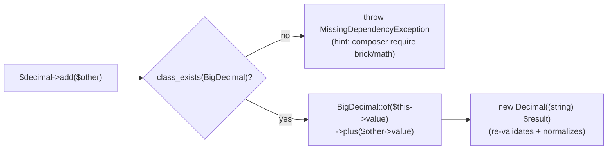

# feat: VO Behavior Enrichment (v1.1)

Turn the library's anemic validators into behavior-carrying domain primitives:
add domain operations to existing value objects (network math, IP predicates,
URL mutators, temporal ops, range/semver behavior, decimal arithmetic) without
breaking the fail-fast, immutable, zero-dependency-core principles. All changes
are **additive** (semver-minor, backward compatible).

Origin: `docs/brainstorms/2026-07-19-vo-behavior-enrichment-requirements.md`.

---

## Problem Frame

Most VOs validate and store a value but expose no behavior — the operation
that is usually the reason to reach for a typed VO. `Cidr` cannot test
`contains()`, `IpAddress` cannot report `isPrivate()`, `Decimal` claims
arbitrary precision but does no arithmetic, `Duration` does not combine.

This plan closes the behavioral gap on **existing** types only. No new VOs
enter the catalogue (that is a separate track, see origin KD1).

**Research delta from the origin doc — a large part of the requested surface
already exists** and is therefore out of this plan's active work:

- `Comparable` is already implemented by `AbstractIntValueObject` and
  `AbstractFloatValueObject` (so `Port`, `Percentage`, `Latitude`,
  `Longitude`, `NonNegativeInt`, `PositiveInt` already order) and explicitly by
  `SemVer` and `Decimal`. The origin's B1 shrinks to **helper methods + one
  missing implementor** (`TimeOfDay`).
- `EmailAddress::local()` / `::domain()` already exist (as strings).
- `Uri` already exposes `scheme/host/port/path/query/fragment`; `Url` exposes
  `scheme/host/port/path`.
- `Cidr` already exposes `address()/prefixLength()/version()`.
- `IntRange::contains()` and `DateRange::contains(point)/overlaps()` already
  exist; `SemVer` already exposes parts + precedence `compareTo`.

The plan targets only the genuine gaps below.

---

## Requirements Traceability

| Origin req | Covered by |
|---|---|
| B1 Comparable everywhere + helpers | U1 |
| B4 Cidr network math | U2 |
| B5 IP predicates | U3 |
| B6 Url/Uri mutators + query parse | U4 |
| B7 Email domain-as-VO | U5 |
| B8 Hostname/DomainName decomposition | U5 |
| B9 Duration behavior | U6 |
| B10 DateRange behavior | U6 |
| B11 TimeOfDay behavior | U1 (ordering) + U6 (arithmetic) |
| B12 Decimal arithmetic | U8 |
| B13 Percentage arithmetic | U8 |
| B14 IntRange behavior | U7 |
| B15 SemVer behavior | U7 |
| B2 immutability / B3 additive | cross-cutting, all units |

---

## Key Technical Decisions

- **KTD1. Network math is zero-dependency via `inet_pton`/`inet_ntop`.**
  `Cidr::contains()`, address arithmetic, and `IpAddress::isInRange()` operate
  on the packed binary string (4 bytes for v4, 16 for v6) and apply the prefix
  mask byte-wise. This covers IPv6 without any bignum library, honoring the
  zero-dep-core rule (origin KD3). `inet_pton`/`inet_ntop` are ext-standard.

- **KTD2. Decimal/Percentage arithmetic delegates to `brick/math`, guarded.**
  Arithmetic methods live **on the VO** (`$d->add(...)`) for ergonomics, but
  each guards with `class_exists(BigDecimal::class)` and throws
  `MissingDependencyException` when `brick/math` is absent. Construction,
  validation, `compareTo`, `isZero`, and serialization keep working without it.
  `brick/math` becomes an optional dep (`suggest` + `require-dev`; already
  present transitively via `brick/money`). This is an accepted, localized
  deviation from "Core references nothing external" — see Alternatives for the
  bridge-based option that was rejected on ergonomics. deptrac is unaffected
  (`brick/math` is an external package, not an internal layer).

- **KTD3. Decimal ships full arithmetic incl. `divide`/`round` this iteration.**
  `add`/`subtract`/`multiply`/`abs`/`negated`/`sign` are exact (no rounding).
  `divide`/`round` take an explicit `int $scale` and a rounding mode, default
  **`RoundingMode::HALF_UP`**, mirroring common decimal conventions. The signature
  accepts `brick/math`'s `RoundingMode` enum — acceptable because these methods
  only run when `brick/math` is installed, and PHP resolves param types lazily
  (the class still loads without the package).

- **KTD4. Duration stays semantically conservative.** ISO 8601 durations with
  year/month components are **not** convertible to a fixed second count and are
  **not** totally ordered without an anchor date (`P1M` vs `P30D` is undefined).
  Therefore Duration gets component-wise `plus`/`minus`/`multipliedBy` (exact,
  lossless) and `isZero`, but **no `Comparable`**, and `toSeconds()` **requires
  an anchor `DateTimeImmutable`** when year/month components are present. This
  mirrors the money caution in origin D6 — no misleading "seconds" that silently
  assume a 30-day month.

- **KTD5. Behavior reuses existing validation (origin KD5).** Accessors that
  return another VO construct it through its normal validating path. Where the
  target type may legitimately not exist for a valid input (an email domain can
  be `localhost` or an IP literal, which is not a registrable `DomainName`), the
  accessor is nullable (`tryFrom` semantics) rather than throwing.

- **KTD6. Mutators are `with*(): static`, never in-place (origin B2/KD4).**
  Every `with*` builds a new instance through the validating constructor; no
  method mutates `$this`. `readonly` guarantees this at the language level.

---

## High-Level Technical Design

### Duration operation-safety matrix (drives U6 scope)

| Operation | Y/M present | No Y/M | Decision |
|---|---|---|---|
| `plus` / `minus` / `multipliedBy` | safe (component-wise) | safe | **ship** |
| `isZero` | safe | safe | **ship** |
| `toSeconds()` | ambiguous → needs anchor | safe | **ship, anchor required for Y/M** |
| `Comparable` / `compareTo` | ambiguous | ambiguous vs Y/M operand | **omit** |

### Optional-dependency guard (U8, Decimal/Percentage arithmetic)

*Directional guidance, not implementation specification.*

---

## Implementation Units

### U1. Comparison ergonomics + TimeOfDay ordering

**Goal:** Give every naturally-ordered VO the convenience comparison surface,
and make `TimeOfDay` orderable.
**Requirements:** B1, B11 (ordering half).
**Dependencies:** none.
**Files:**
- `src/Support/ComparableHelpers.php` (new trait: `isLessThan`, `isGreaterThan`,
  `isLessThanOrEqual`, `isGreaterThanOrEqual`, `min`, `max` — all derived from
  `compareTo`)
- `src/Support/AbstractIntValueObject.php`, `src/Support/AbstractFloatValueObject.php`
  (use the trait)
- `src/Finance/Decimal.php`, `src/Format/SemVer.php` (use the trait)
- `src/Temporal/TimeOfDay.php` (implement `Comparable` + use trait)
- `tests/Unit/Support/ComparableHelpersTest.php` (new)
- `tests/Unit/Temporal/TimeOfDayTest.php` (extend)
**Approach:** Trait provides default helpers on top of the existing
`compareTo(Comparable): int`. `TimeOfDay` stores canonical `HH:MM:SS`, so
`compareTo` is a plain string comparison (lexicographic == chronological);
reject cross-type comparison with `InvalidValueObjectException` like the bases do.
`min`/`max` return `static`.
**Patterns to follow:** `compareTo` guard in `AbstractIntValueObject`.
**Test scenarios:**
- Happy: `min`/`max` pick the correct instance; `isLessThan`/`isGreaterThan`
  agree with `compareTo` sign across int, float, decimal, semver, time-of-day.
- Edge: equal operands → `isLessThan` false, `isLessThanOrEqual` true; `min` of
  equals returns a value-equal instance.
- Error: comparing `TimeOfDay` with a non-`TimeOfDay` `Comparable` throws.
- `TimeOfDay`: `00:00:00` < `23:59:59`; seconds-omitted input `08:30` (stored
  `08:30:00`) compares correctly with `08:30:01`.
**Verification:** New helper methods available on all listed VOs; sorting an
array via `compareTo` yields chronological/numeric order; suite green.

### U2. Cidr network math

**Goal:** Make `Cidr` answer containment and address-range questions.
**Requirements:** B4.
**Dependencies:** none (uses existing `Cidr::address()`/`prefixLength()`).
**Files:**
- `src/Network/Cidr.php` (add methods)
- `tests/Unit/Network/CidrTest.php` (extend)
**Approach:** Convert the network address to its packed binary via `inet_pton`;
build a prefix mask over the byte array; compute:
- `contains(IpAddress): bool` — pack the candidate, reject on version mismatch,
  compare masked bytes.
- `firstAddress(): IpAddress` / `lastAddress(): IpAddress` — network and
  all-ones-host addresses, rebuilt with `inet_ntop`.
- `netmask(): IpAddress` — mask as an address (both families).
- `broadcast(): IpAddress` — v4 only; throw `\LogicException` for v6 (no
  broadcast concept), or document as `?IpAddress` returning null for v6 (decide
  in Open Questions).
- `hostCount(): int` — usable host count; see Open Questions for IPv6 overflow.
- `overlaps(self): bool`, `isSubnetOf(self): bool` — range-vs-range on binary
  bounds; version mismatch ⇒ false.
**Patterns to follow:** binary handling stays inside `Cidr`; return values are
existing VOs (`IpAddress`) per KTD5.
**Test scenarios:**
- Covers B4. Happy (v4): `192.168.1.0/24` contains `192.168.1.42`, excludes
  `192.168.2.1`; `firstAddress`=`.0`, `lastAddress`=`.255`, `netmask`=
  `255.255.255.0`, `broadcast`=`.255`, `hostCount`=254.
- Happy (v6): `2001:db8::/32` contains `2001:db8::1`, excludes `2001:db9::1`;
  `firstAddress`/`lastAddress` correct; `netmask`=`ffff:ffff::`.
- Edge: `/32` (v4) and `/128` (v6) single-host ranges; `/0` matches everything;
  `/31` host counting.
- Error: `contains()` with an `IpAddress` of the other family → false, not throw;
  `broadcast()` on a v6 `Cidr` → per Open-Questions resolution.
**Verification:** All new methods return correct addresses/booleans for v4 and
v6 fixtures; no `brick/math` in the autoload path exercised by these tests.

### U3. IP address predicates

**Goal:** Classify IP addresses and test range membership.
**Requirements:** B5.
**Dependencies:** U2 (`isInRange` uses `Cidr::contains`).
**Files:**
- `src/Network/Ipv4Address.php`, `src/Network/Ipv6Address.php`,
  `src/Network/IpAddress.php` (add predicates)
- `tests/Unit/Network/Ipv4AddressTest.php`,
  `tests/Unit/Network/Ipv6AddressTest.php`,
  `tests/Unit/Network/IpAddressTest.php` (extend)
**Approach:** Add `isPrivate()`, `isLoopback()`, `isLinkLocal()`,
`isMulticast()`, `isPublic()`, `isInRange(Cidr): bool`. Prefer PHP's
`FILTER_FLAG_NO_PRIV_RANGE` / `NO_RES_RANGE` where they map cleanly; otherwise
test against the well-known reserved `Cidr` blocks (RFC 1918, 127.0.0.0/8,
169.254.0.0/16, ::1/128, fc00::/7, fe80::/10, multicast ranges) reusing U2's
`contains`. `IpAddress` delegates to the concrete family based on `version()`.
`isPublic()` == not private/loopback/link-local/reserved.
**Patterns to follow:** version dispatch mirrors `IpAddress::version()`.
**Test scenarios:**
- Covers B5. Happy: `10.0.0.1`/`192.168.1.1`/`172.16.0.1` private; `8.8.8.8`
  public; `127.0.0.1` and `::1` loopback; `169.254.1.1` and `fe80::1`
  link-local; `224.0.0.1` and `ff02::1` multicast.
- Edge: boundaries of each RFC 1918 block (e.g. `172.15.255.255` public vs
  `172.16.0.0` private); `isInRange` true/false against a `Cidr`.
- Integration: `IpAddress::from('10.0.0.1')->isPrivate()` delegates to the v4
  path and matches `Ipv4Address` directly.
**Verification:** Predicate truth tables match RFC-defined ranges for both
families; `isInRange` agrees with `Cidr::contains`.

### U4. Url / Uri mutators and query parsing

**Goal:** Allow deriving modified URLs/URIs immutably and reading query params.
**Requirements:** B6.
**Dependencies:** none.
**Files:**
- `src/Network/Url.php`, `src/Network/Uri.php` (add `with*` + `queryParameters`)
- `tests/Unit/Network/UrlTest.php`, `tests/Unit/Network/UriTest.php` (extend)
**Approach:** Add `withScheme`, `withHost`, `withPort`, `withPath`, `withQuery`,
`withFragment` (those applicable to each type) returning `static`. Each rebuilds
the string form and passes it back through the validating constructor (KTD6), so
an invalid combination throws the type's existing exception. Add
`queryParameters(): array<string, string>` via `parse_str` over the raw query
(distinct from the existing raw `query()` string on `Uri`). Rebuild uses a small
private assembler from `parse_url` components.
**Patterns to follow:** existing `component()` helper in both classes.
**Test scenarios:**
- Covers B6. Happy: `withPath('/new')` on `https://h/old?q=1` yields
  `https://h/new?q=1`; `withQuery('a=1&b=2')` then `queryParameters()` ==
  `['a'=>'1','b'=>'2']`; `withPort(8443)` reflected in `port()`.
- Edge: empty query → `queryParameters()` == `[]`; `withFragment('')` removes
  fragment; repeated keys `a=1&a=2` follow `parse_str` last-wins.
- Error: `Url::withScheme('ftp')` throws `InvalidUrlException` (http/https only);
  `withHost('')` throws.
- Immutability: original instance unchanged after every `with*`.
**Verification:** `with*` returns new validated instances; original untouched;
query parsing round-trips.

### U5. Email / Hostname / DomainName decomposition

**Goal:** Expose structural parts of addresses as VOs where meaningful.
**Requirements:** B7, B8.
**Dependencies:** none.
**Files:**
- `src/Identity/EmailAddress.php` (add `domainName(): ?DomainName`)
- `src/Network/DomainName.php`, `src/Network/Hostname.php`
  (add `labels()`, `tld()`, `isSubdomainOf()`)
- `tests/Unit/Identity/EmailAddressTest.php`,
  `tests/Unit/Network/DomainNameTest.php`,
  `tests/Unit/Network/HostnameTest.php` (extend)
**Approach:** `EmailAddress::domainName()` returns `DomainName::tryFrom($this->domain())`
— nullable because a valid email domain may be `localhost` or an IP literal
`[192.168.0.1]` that is not a registrable domain (KTD5). Keep the existing
string `domain()`/`local()` untouched. `DomainName`/`Hostname` add
`labels(): list<non-empty-string>` (`explode('.')`), `tld(): string` (last
label), and `isSubdomainOf(self): bool` (suffix-of-labels test, not raw string
`str_ends_with`, to avoid `notevil.com` matching `evil.com`).
**Patterns to follow:** values are already lowercased at construction, so label
splitting is canonical.
**Test scenarios:**
- Covers B7/B8. Happy: `user@example.com`→`domainName()` == `DomainName('example.com')`;
  `www.example.com` labels `['www','example','com']`, tld `com`;
  `api.example.com`->`isSubdomainOf(example.com)` true.
- Edge: `user@localhost`→`domainName()` null; `example.com`->`isSubdomainOf(example.com)`
  false (not a strict subdomain — decide equality case in Open Questions);
  `evilexample.com`->`isSubdomainOf(example.com)` false.
- Error/null path: email with IP-literal domain → `domainName()` null, not throw.
**Verification:** Structural accessors return canonical parts; subdomain test is
label-boundary correct; email domain-as-VO is null for non-registrable domains.

### U6. Temporal behavior — Duration, DateRange, TimeOfDay arithmetic

**Goal:** Combine and measure temporal values within safe semantics (KTD4).
**Requirements:** B9, B10, B11 (arithmetic half).
**Dependencies:** U1 (TimeOfDay is `Comparable` by now).
**Files:**
- `src/Temporal/Duration.php` (add `plus`, `minus`, `multipliedBy`, `isZero`,
  `toSeconds`)
- `src/Temporal/DateRange.php` (add `duration`, `intersect`, `gap`,
  `contains(self)`, `isAdjacentTo`)
- `src/Temporal/TimeOfDay.php` (add `plus`, `minus`)
- `tests/Unit/Temporal/DurationTest.php`,
  `tests/Unit/Temporal/DateRangeTest.php`,
  `tests/Unit/Temporal/TimeOfDayTest.php` (extend)
**Approach:**
- Duration `plus`/`minus`/`multipliedBy` combine `DateInterval` components
  (y,m,d,h,i,s) directly and re-serialize to canonical ISO 8601 via a private
  assembler (not `DateInterval::format`, which cannot omit zero components).
  `minus` that would go negative throws `InvalidDurationException` (no negative
  ISO durations). `toSeconds(?DateTimeImmutable $anchor = null): int` — with no
  Y/M and no anchor, sum from fixed units; with Y/M, require `$anchor` and
  compute `$anchor->add($interval)->getTimestamp() - $anchor->getTimestamp()`;
  throw when Y/M present and anchor missing.
- DateRange: `duration(): Duration` (diff of endpoints → ISO string);
  `intersect(self): ?self` (null when disjoint); `gap(self): ?self` (null when
  overlapping/adjacent); `contains(self): bool`; `isAdjacentTo(self): bool`
  (endpoints touch with no overlap). All times UTC (origin rule).
- TimeOfDay: `plus(Duration)`/`minus(Duration)` apply **time components only**;
  reject a Duration carrying Y/M/D/W with `InvalidTimeOfDayException`; wrap
  modulo 24h (decide wrap-vs-throw in Open Questions — default wrap).
**Patterns to follow:** existing `DateRange::overlaps`/`contains(point)`.
**Test scenarios:**
- Covers B9: `P1Y` `plus` `P2M` == `P1Y2M`; `PT30M` `multipliedBy` 3 == `PT90M`;
  `P1M` `minus` `P1M` `isZero`; `PT90M` `toSeconds()` == 5400; `P1M`
  `toSeconds()` without anchor throws; `P1M` `toSeconds(2026-01-01)` == 2678400
  (31-day January).
- Covers B10: overlapping ranges `intersect` to the overlap; disjoint →
  `intersect` null and `gap` non-null; touching ranges `isAdjacentTo` true and
  `gap` null; `duration()` of a one-hour range == `PT1H`; `contains(self)` for a
  fully-enclosed range.
- Covers B11: `23:30:00` `plus` `PT1H` wraps to `00:30:00`; `plus` `P1D` throws;
  `08:00:00` `minus` `PT30M` == `07:30:00`.
- Edge: zero-length range intersect with itself; negative `minus` on Duration
  throws.
- Immutability: operands unchanged after every operation.
**Verification:** Temporal arithmetic is component-correct; ambiguous paths
throw with clear messages rather than guessing; all UTC.

### U7. IntRange and SemVer behavior

**Goal:** Round out range and version operations.
**Requirements:** B14, B15.
**Dependencies:** none.
**Files:**
- `src/Primitive/IntRange.php` (add `length`, `overlaps`, `intersect`)
- `src/Format/SemVer.php` (add `isStable`, `nextMajor`, `nextMinor`, `nextPatch`)
- `tests/Unit/Primitive/IntRangeTest.php`,
  `tests/Unit/Format/SemVerTest.php` (extend)
**Approach:** `IntRange::length(): non-negative-int` == `max - min + 1`;
`overlaps(self): bool`; `intersect(self): ?self` (null when disjoint).
`SemVer::isStable(): bool` == major ≥ 1 and no prerelease; `nextMajor/Minor/Patch()`
return a new `SemVer` with the bumped component zeroing lower ones and dropping
prerelease/build (KTD6, `with*` semantics). Reuse the existing `parts()` accessor.
**Patterns to follow:** existing `SemVer::parts()`; existing `IntRange::contains`.
**Test scenarios:**
- Covers B14: `[1,5]` length 5; `[1,5]` overlaps `[4,9]`, `intersect`==`[4,5]`;
  `[1,2]` and `[5,6]` disjoint → `intersect` null; single-point `[3,3]` length 1.
- Covers B15: `1.2.3`→`nextMajor`=`2.0.0`, `nextMinor`=`1.3.0`, `nextPatch`=`1.2.4`;
  `1.2.3-rc.1`→`nextPatch`=`1.2.4` (prerelease dropped); `0.9.0` not stable,
  `1.0.0` stable, `1.0.0-alpha` not stable.
- Edge: `intersect` of touching-but-not-overlapping integer ranges `[1,3]`,`[4,6]`
  → null (integers, no shared point).
- Immutability: `next*` returns new `SemVer`; original unchanged.
**Verification:** Range algebra and version bumping produce correct new VOs.

### U8. Decimal & Percentage arithmetic via brick/math

**Goal:** Real arithmetic on `Decimal` and `Percentage`, delegated and guarded.
**Requirements:** B12, B13.
**Dependencies:** none (independent of U1–U7).
**Files:**
- `composer.json` (add `brick/math` to `require-dev` + `suggest`)
- `src/Exception/MissingDependencyException.php` (new, `extends \RuntimeException`)
- `src/Finance/Decimal.php` (add arithmetic)
- `src/Primitive/Percentage.php` (add `of`, `applyTo`, `fromRatio`)
- `tests/Unit/Finance/DecimalTest.php`,
  `tests/Unit/Primitive/PercentageTest.php` (extend)
- `tests/Unit/Finance/DecimalWithoutBrickMathTest.php` (new — proves the guard;
  see Open Questions on how to simulate absence)
**Approach:** Each arithmetic method first checks `class_exists(\Brick\Math\BigDecimal::class)`
and throws `MissingDependencyException` with an install hint when absent (KTD2).
- Decimal: `add`, `subtract`, `multiply` (exact); `divide(self $d, int $scale,
  RoundingMode $mode = RoundingMode::HALF_UP)`; `round(int $scale, RoundingMode
  $mode = RoundingMode::HALF_UP)`; `abs`, `negated`, `sign(): int`. Each converts
  via `BigDecimal::of($this->value)`, operates, and returns `new Decimal((string)
  $result)` so the result is re-normalized by the existing `parse()` (KTD3).
- Percentage: `applyTo(Decimal|int|string): Decimal` == value × pct/100;
  `of(Decimal|int|string): Decimal` (alias/ratio direction — settle naming in
  Open Questions); `fromRatio(numerator, denominator): self` == part/whole×100
  via brick/math (needs division ⇒ guarded).
**Patterns to follow:** the existing `brick/money` optional-bridge pattern; the
`Decimal::compareTo` normalization contract.
**Test scenarios:**
- Covers B12: `1.1` add `2.2` == `3.3`; `0.1` multiply `0.2` == `0.02`;
  `1` divide `3` scale 4 HALF_UP == `0.3333`; `2.5` round 0 HALF_UP == `3`;
  `-4.20` abs == `4.2`, `negated` == `-4.2`... ; `sign()` of negative/zero/positive
  == -1/0/1; result strings are normalized (no trailing zeros where parse strips).
- Covers B13: `Percentage(20)->applyTo('150')` == `30`; `fromRatio(1,4)` == `25`;
  `applyTo` of `0` == `0`.
- Error (guard): with `brick/math` unavailable, `Decimal::add` throws
  `MissingDependencyException`; **construction, `compareTo`, `isZero`,
  serialization still succeed**.
- Edge: division by zero throws (brick/math `DivisionByZeroException` wrapped or
  surfaced — decide in Open Questions); non-terminating division without scale
  is impossible because scale is required.
- Immutability: operands unchanged.
**Verification:** Arithmetic results are exact/correctly-rounded; the guard path
is proven by a test exercising absence; core install (no brick/math) still
validates decimals. `make check` green (PHPStan 9 sees brick/math in dev).

---

## Scope Boundaries

- **No new VOs** — Timezone, Ulid/Nanoid, PostalCode, Ean/Isbn, Bytes, typed
  collections are a separate future track (origin KD1).
- **No network I/O** — only value computation (masks, ranges); no DNS/ping/HTTP.
- **No own arbitrary-precision engine** — arithmetic is `brick/math` only (KTD2).
- **No Doctrine/Symfony bridge changes** — behavior does not alter serialized
  form, so existing Types/Constraints are untouched. (If `MissingDependencyException`
  ever needs to surface through a bridge, that is follow-up.)
- **No `Duration` `Comparable` / anchorless `toSeconds` for Y/M** (KTD4).
- **No violation-collecting validation path** — still fail-fast (origin).

### Deferred to Follow-Up Work

- `brick/money`-backed Doctrine type change for a two-column money mapping
  (already tracked in known-issues) — unrelated to behavior.
- A typed `QueryString` VO (U4 uses a plain parsed array for now).
- `Cidr::hostCount` returning a bignum for very wide IPv6 prefixes (see Open
  Questions) — ship the `int` form first.

---

## Open Questions

### Resolve during implementation

- **[U2]** `Cidr::broadcast()` on IPv6: throw `\LogicException` vs return
  `?IpAddress` null. Lean: nullable, documented — v6 has no broadcast.
- **[U2]** `Cidr::hostCount()` overflow for IPv6 prefixes below ~64: throw
  `\RangeException` vs cap. Lean: throw with a clear message; bignum form deferred.
- **[U5]** `isSubdomainOf`: is a domain a subdomain of itself? Lean: no (strict),
  matching common intuition; document either way.
- **[U6]** `TimeOfDay::plus/minus` wrap vs throw on 24h overflow. Lean: wrap
  modulo 24h (origin B11 hint), documented.
- **[U8]** `Percentage::of` vs `applyTo` naming/direction — pick one primary,
  keep the other only if it reads clearly.
- **[U8]** Division-by-zero: wrap brick/math's exception in
  `InvalidDecimalException` vs let it surface. Lean: wrap for a consistent
  library exception family.
- **[U8]** How the guard test simulates `brick/math` absence without uninstalling
  it (e.g. a dedicated core-only CI leg that excludes dev arithmetic deps, or a
  test double). The existing `.gitlab-ci.yml` already runs a "core-only" leg —
  extend it to assert the guard throws.

---

## Risks & Dependencies

- **`brick/math` reference inside Core (`Decimal`).** Mitigation: `class_exists`
  guard + `MissingDependencyException`; a core-only test proves validation works
  without the package. Accepted, localized deviation (KTD2).
- **IPv6 binary math correctness.** Mitigation: table-driven tests over known v6
  ranges; rely on `inet_pton`/`inet_ntop` for canonicalization rather than
  hand-parsing.
- **ISO 8601 re-serialization of `Duration`.** `DateInterval::format` is a poor
  ISO emitter; a hand-rolled assembler is needed and must round-trip through the
  existing `parse()`. Mitigation: property-style round-trip tests (parse→ops→
  serialize→parse).
- **Tooling gate.** Every unit must pass `make check` (PHPStan 9, cs-fixer,
  rector, deptrac) + `make test`, plus `mcp__phpstorm__get_inspections` on each
  changed file, per project rules. Infection MSI must not regress.

---

## Alternatives Considered

- **Arithmetic in a `Bridge\BrickMath\DecimalMath` helper instead of on the VO.**
  Keeps Core strictly free of external symbols (matches the money bridge exactly).
  Rejected for ergonomics: `$decimal->add($other)` is the whole point of the
  iteration; `DecimalMath::add($decimal, $other)` reintroduces the friction VOs
  exist to remove. The `class_exists` guard recovers the safety the bridge would
  have given. (Revisit if a future strict-zero-dep audit forbids the reference.)
- **Duration `Comparable` with documented 30-day-month / 365-day-year
  assumptions.** Rejected (KTD4): silently wrong for real calendars; the origin's
  own money decision (D6) warns against exactly this kind of convenient-but-wrong
  shortcut. Consumers needing comparison use `toSeconds($anchor)`.

---

## Sources & Research

- Origin requirements: `docs/brainstorms/2026-07-19-vo-behavior-enrichment-requirements.md`.
- Existing surface confirmed by reading `src/Network/Cidr.php`,
  `src/Network/Ipv4Address.php`, `src/Network/Ipv6Address.php`,
  `src/Network/IpAddress.php`, `src/Network/Url.php`, `src/Network/Uri.php`,
  `src/Identity/EmailAddress.php`, `src/Network/DomainName.php`,
  `src/Network/Hostname.php`, `src/Temporal/Duration.php`,
  `src/Temporal/TimeOfDay.php`, `src/Temporal/DateRange.php`,
  `src/Finance/Decimal.php`, `src/Primitive/Percentage.php`,
  `src/Primitive/IntRange.php`, `src/Format/SemVer.php`, and the `Support`
  abstract bases (which already implement `Comparable`).
- Conventions/constraints: `.claude/docs/conventions.md`,
  `.claude/docs/known-issues.md`, `deptrac.yaml` (Core must not reference Bridge).
- `brick/math` already vendored transitively via `brick/money`.
