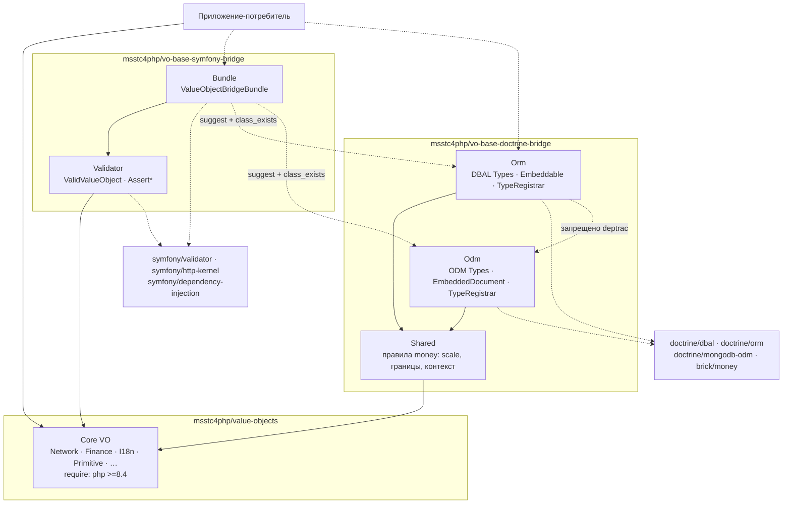
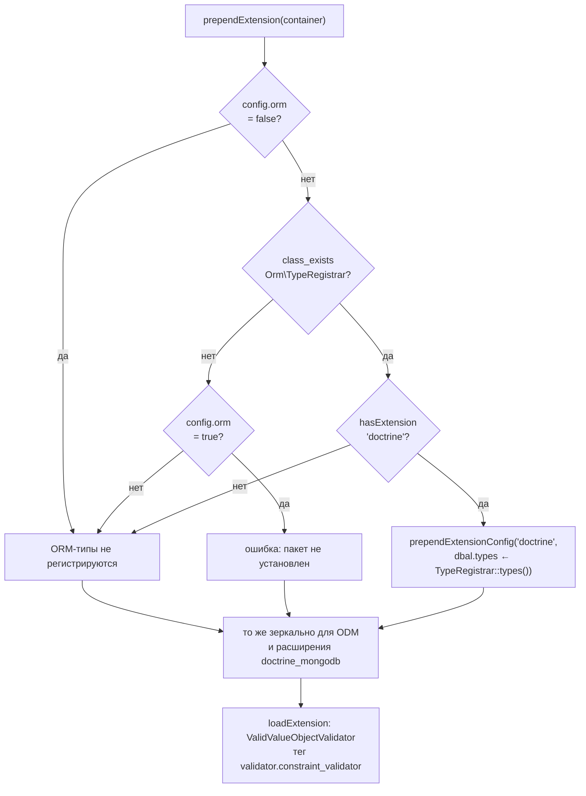
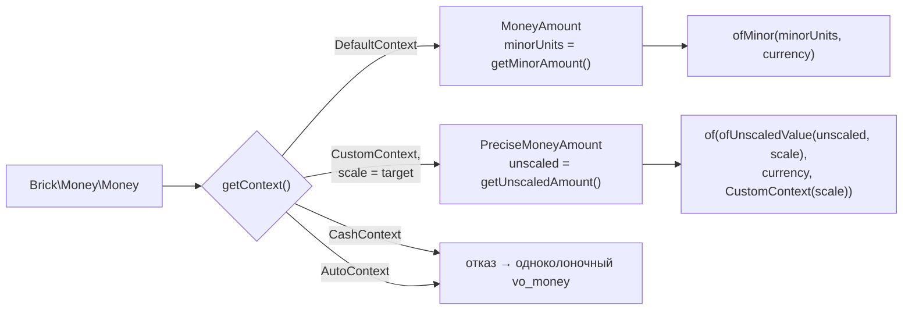

# refactor: Разделить фреймворк-мосты на два пакета и достроить money-маппинг

**Целевые репозитории:** три. Пути без префикса относятся к репозиторию, где живёт этот документ.

| Префикс пути | Репозиторий | Состояние |
|---|---|---|
| (без префикса) | `vo-base` — ядро и донор | существует, ветка `feat/value-objects-library` |
| `dbr:` | `vo-base-doctrine-bridge` | **создаётся этим планом** |
| `sbr:` | `vo-base-symfony-bridge` | существует, бутстрап и тулинг закоммичены |

---

## Summary

Три фреймворк-моста живут внутри ядра в `src/Bridge/`. План выносит Doctrine-ветку (ORM + ODM, 67 классов) в новый пакет `msstc4php/vo-base-doctrine-bridge`, Symfony-ветку (Validator + новый Bundle) — в существующий `msstc4php/vo-base-symfony-bridge`, и зачищает ядро до состояния без единого упоминания фреймворка.

Попутно закрываются три вещи, обнаруженные при разборе: пробел покрытия примитивов (12 недостающих типов), дефект разрядности валют в ядре (16 валют считаются по CLDR там, где нужен ISO 4217), и дефект двух перенесённых типов — `BrickMoneyType` и `DateRangeType` пишут значения, которые сами не могут прочитать. Добавляются четыре money-embeddable — базовый и высокоточный, каждый в двух ветках.

Работа разложена на три полосы коммитов: **правки ядра → чистая релокация → новый код**. Порядок не косметический: релокация верифицируется диффом, и это единственный масштабируемый способ доказать, что перенос 92 файлов ничего не сломал.

---

## Problem Frame

**Что не так.** Ядро и мосты делят релизный цикл. Любой апгрейд Doctrine или Symfony двигает репозиторий ядра, хотя ядро к ним не притрагивается. CI ядра ставит `intl`, `mongodb`, `bcmath` и весь Doctrine-стек ради `make check`. Потребитель, которому нужны только value objects, читает README, наполовину состоящий из инструкций по Doctrine.

**Почему два пакета мостов, а не один.** Doctrine-ветка не зависит от Symfony ни в одной точке. Предыдущий план (`sbr: docs/plans/2026-07-27-001-refactor-extract-framework-bridges-plan.md`) складывал обе ветки в один пакет и был вынужден удерживать их независимость правилом deptrac и отдельными CI-задачами изоляции — то есть сам признавал, что в коробке лежат два несвязанных куска, а имя называет только один. Ни один пакет не опубликован, поэтому разделение стоит только работы.

**Состояние работ.** Из девяти юнитов предыдущего плана закоммичены два (бутстрап и тулинг `sbr:`). ORM-файлы скопированы в `sbr: src/Doctrine/Orm/` и `sbr: tests/Doctrine/Orm/`, но **не закоммичены** — истории у них нет, поэтому они переезжают в новый репозиторий обычным копированием, а не переписыванием истории.

---

## Requirements

Требования наследуются из origin-документа без переформулирования. Здесь — только трассировка на юниты.

| ID | Кратко | Юниты |
|---|---|---|
| R1 | Doctrine-ветка живёт в своём пакете, в ядре её нет | U3, U4, U16 |
| R2 | Symfony-ветка живёт в своём пакете, в ядре её нет | U12, U16 |
| R3 | Релокация не меняет поведение; новый код — отдельными коммитами | U3, U4, U7, U12 |
| R4 | Doctrine-пакет требует только `php >=8.4` и ядро | U2 |
| R5 | Doctrine-пакет не упоминает Symfony нигде | U2, U10 |
| R6 | Symfony-пакет не требует Doctrine-пакет; Bundle гейтит через `class_exists` | U12, U13, U14, U15 |
| R7 | Три группы Bundle управляемы конфигурацией | U13, U14 |
| R8 | 12 типов для примитивов, паритет ORM ↔ ODM | U6 |
| R9 | Двухколоночный money-embeddable | U8 |
| R10 | Money-embeddable полноценен без `brick/money` | U5, U8, U9 |
| R11 | Свой комплект тулинга и CI у каждого пакета мостов | U2, U10, U11, U15 |
| R12 | CI доказывает autoload-безопасность; deptrac запрещает Orm ↔ Odm | U2, U4, U10 |
| R13 | В ядре нет упоминаний Doctrine и Symfony Validator | U16 |
| R14 | Машинный запрет на возврат фреймворков в ядро | U16 |
| R15 | Работа в ядре не коммитится — коммитит владелец | U1, U16 |
| R16 | Scale в money — только `isoMinorUnits()` | U5, U8 |
| R17 | Контекст `Money` маршрутизирует выбор типа | U5, U8 |
| R18 | Валюты без ISO-разрядности отвергаются; ограничение задокументировано | U5, U8, U11 |
| R19 | `isoMinorUnits()` в ядре; `minorUnits()` → `displayFractionDigits()` | U1 |
| R20 | Контрактный тест паритета на 166 кодах | U8 |
| R21 | Высокоточный дубль, scale = `isoMinorUnits() + 2` | U9 |
| R22 | Реконструкция через `ofUnscaledValue`, не `ofMinor` | U9 |
| R23 | Неявного округления нет; сужение — явным методом | U9 |
| R24 | Отказ на валюте без ISO-разрядности; граница int64 | U5, U8, U9 |
| R25 | Исправить `BrickMoneyType` — писать читаемое | U7 |

---

## Key Technical Decisions

### KTD1 — Раздельные корневые namespace, без слоя совместимости

`MSSTC4PHP\ValueObject\Bridge\Doctrine\Orm\EmailAddressType` → `MSSTC4PHP\ValueObjectDoctrineBridge\Orm\EmailAddressType`.
`MSSTC4PHP\ValueObject\Bridge\Symfony\Validator\AssertUuid` → `MSSTC4PHP\ValueObjectSymfonyBridge\Validator\AssertUuid`.

Каждый пакет владеет своим корнем целиком: по FQCN сразу видно, какой пакет принёс класс, и частичная установка не выглядит дырой в общем дереве. Сегмент `Bridge` из пути исчезает — он выражен именем пакета.

Алиасы старых FQCN не создаются. Пакеты не опубликованы, внешних потребителей нет, слой совместимости был бы мёртвым кодом с рождения.

Уже закоммиченный `sbr: composer.json` объявляет PSR-4 на `MSSTC4PHP\ValueObjectBridge\` — это правится в U12.

Одно осознанное исключение: класс `ValueObjectBridgeBundle` и ключ конфигурации `value_object_bridge` остаются нейтральными, без имени пакета. Это единственные два имени, которые потребитель печатает руками, и бандл действительно охватывает оба пакета — привязка к Symfony-пакету в имени вводила бы в заблуждение относительно групп `orm`/`odm`.

### KTD2 — Все фреймворки остаются опциональными

Ни `doctrine/dbal`, ни `doctrine/orm`, ни `doctrine/mongodb-odm`, ни `symfony/*`, ни `brick/money` не попадают в `require` ни одного из трёх пакетов. Только `require-dev` + `suggest`. Инвариант autoload-безопасности проверяется машинно (U10, U15), а не договорённостью.

### KTD3 — Bundle видит Doctrine-пакет опционально

`sbr: composer.json` объявляет `msstc4php/vo-base-doctrine-bridge` в `suggest`, не в `require`. Bundle гейтит регистрацию двойным условием: `class_exists(Orm\TypeRegistrar::class)` **и** `hasExtension('doctrine')`. Первое отвечает на «поставлен ли пакет», второе — на «есть ли куда prepend-ить». Жёсткий `require` вернул бы 74 типа (по 37 в каждом реестре после U6) потребителю на Symfony без Doctrine и связал бы релизные циклы двух пакетов.

### KTD4 — Источник разрядности один, дрейф ловится тестом

Рантайм-источник ISO 4217 minor units — `CurrencyCode::isoMinorUnits()` из ядра. Прямых обращений к `Currency::getDefaultFractionDigits()` в коде мостов нет. `brick/money` участвует дважды: как вход генератора энама в `require-dev` ядра и как эталон в контрактном тесте (U8), падающем при расхождении версий.

Измерено на установленных версиях: из 294 значений `CurrencyCode` 16 расходятся с `brick/money`, 128 исторических кодов ISO-реестру `brick/money` неизвестны. Причина — `symfony/intl` отдаёт display-разрядность CLDR, `brick/money` — официальные minor units. Две рантайм-таблицы воспроизвели бы ту же ошибку при расхождении версий.

### KTD5 — ODM хранит money в `int64`, а не `Decimal128`

Решение владельца: одинаковый PHP-API двух веток важнее читаемости сырых значений в базе. `int64` — прямой аналог `BIGINT`, `$sum` в агрегации Mongo работает так же. `Decimal128` дал бы человекочитаемое значение в документе ценой расхождения формата хранения между ветками.

### KTD6 — Общая логика money живёт в третьем слое

Четыре money-embeddable (базовый и высокоточный × ORM/ODM) несут одинаковые правила: вычисление scale, границы int64, отказ на неподходящем контексте, конвертация в `Brick\Money\Money`. Дублировать их четырежды нельзя, а связать Orm с Odm запрещает deptrac.

Поэтому в `dbr: src/Shared/` появляется слой, от которого зависят обе ветки и который не зависит ни от одной. Мапящие классы остаются тонкими: атрибуты плюс делегирование.

### KTD7 — Разрешение зависимости на ядро до его публикации

У `vo-base` нет тегов. Оба пакета мостов подключают ядро временной `repositories` записью типа `path` с симлинком (как уже сделано в `sbr: composer.json`). Строка помечается комментарием-задачей на снятие после первого тега.

**Следствие для CI, которое надо принять сознательно.** `path`-репозиторий разрешается только там, где рядом лежит каталог ядра. На CI-раннере его нет, поэтому задачи U10 и U15 обязаны сначала клонировать `vo-base` в `../vo-base` — **с явным указанием ветки**: Composer выводит версию `path`-пакета из имени выкаченной ветки, а закоммиченный `sbr: composer.json` требует `dev-feat/value-objects-library as 1.1.0`. Клон без `--branch` даст другую версию, и `composer install` упадёт на несовпадении констрейнта, не дойдя до тестов.

**Предусловие, которого сейчас нет.** У ветки `feat/value-objects-library` нет upstream, на remote не выложено ничего. Пока это так, условие разблокировки CI — не «владелец закоммитил», а «владелец закоммитил **и запушил** ветку». Без push шаг клонирования отдаст пустой репозиторий или ветку по умолчанию, и CI не стартует вовсе. Но клонированная ветка содержит только закоммиченное, а по KTD8 правки U1 остаются в рабочем дереве до конца работ — значит до коммита владельца CI пакетов мостов **не может быть зелёным на money-юнитах**: `isoMinorUnits()` в клоне отсутствует. Пока это так, гейтом качества служит локальный прогон, а не CI. Verification U10 и U15 сформулированы соответственно.

Дополнительно: у `vo-base-symfony-bridge` нет git-remote, а `vo-base-doctrine-bridge` ещё не создан — CI-конфиги из U10 и U15 до заведения удалённых репозиториев пишутся «в стол» и проверяются локальным запуском шагов.

### KTD8 — Работа ведётся на изменённом рабочем дереве до конца

Решение владельца. Правки ядра (U1) блокируют money-юниты, но план не останавливается на ожидании коммита: `vo-base` остаётся с незакоммиченными изменениями, пакеты мостов подключают его симлинком и видят правки немедленно. R15 сохраняется — коммитит владелец, но в конце, а не посередине.

Цена решения зафиксирована в KTD7: до коммита ядра CI пакетов мостов зелёным быть не может, и верификация опирается на локальный прогон. Это осознанный размен «не блокировать работу ожиданием коммита» против «CI как гейт качества», а не упущение.

**Рассмотрено и отклонено:** размен делим — U1 не имеет зависимостей, а U16 мостам не нужен, поэтому ранний коммит одного U1 вернул бы CI в работу с середины, оставив незакоммиченным только U16. Владелец выбрал единый коммит в конце. Следствие принимается целиком: релокация 92 файлов завершается, опираясь на двухшаговую дифф-сверку и локальные прогоны, а первый зелёный CI приходит после передачи ядра — он вынесен в завершающий шаг ниже.

---

## High-Level Technical Design

### Форма зависимостей после разделения



Сплошные стрелки — жёсткие зависимости кода. Пунктир — опциональное: пакеты, которые ставит потребитель, и связь Bundle → Doctrine-пакет, существующая только когда пакет установлен.

### Решения Bundle при сборке контейнера



Ключевая разница с предыдущим планом — узел `class_exists`: пакет может отсутствовать целиком, и это не ошибка, пока конфигурация не потребовала группу явно.

### Хранение и восстановление money

Четыре embeddable различаются двумя осями: что лежит в целочисленной колонке и по какому scale оно разворачивается.

| | Базовый `MoneyAmount` | Высокоточный `PreciseMoneyAmount` |
|---|---|---|
| Колонка | `minorUnits` | `unscaledValue` |
| Scale | `isoMinorUnits(currency)` | `isoMinorUnits(currency) + 2` |
| USD | `1.23` → `123` | `1.2345` → `12345` |
| JPY | `1234` → `1234` | `1234.56` → `123456` |
| IQD | `1.234` → `1234` | `1.23456` → `123456` |
| Принимает контекст | `DefaultContext` | `CustomContext` с целевым scale |



Правая ветвь — не стилистический выбор. `Money::ofMinor()` делит на `10 ** isoMinorUnits`, игнорируя scale контекста: `ofMinor(12345, 'USD', CustomContext(4))` даёт `USD 123.4500` вместо `USD 1.2345`. Проверено на установленной версии.

---

## Output Structure

```
vo-base-doctrine-bridge/
├── composer.json · Makefile · README.md · LICENSE · .gitignore
├── deptrac.yaml · phpunit.xml.dist · rector.php · .php-cs-fixer.dist.php
├── phpstan.dist.neon · phpstan-ci.neon · phpstan-baseline.neon
├── .github/workflows/ci.yml · .gitlab-ci.yml
├── .claude/docs/{README,architecture,integrations,conventions,known-issues}.md
├── src/
│   ├── Shared/Money/          # правила scale, границы, маршрутизация контекста
│   ├── Orm/                   # Abstract*VoType, 37 *Type, TypeRegistrar
│   │   └── Embeddable/        # MoneyAmount, PreciseMoneyAmount
│   └── Odm/                   # Abstract*VoType, 37 *Type, TypeRegistrar
│       └── Embeddable/        # MoneyAmount, PreciseMoneyAmount
└── tests/
    ├── Shared/ · Orm/ · Odm/
    └── Contract/              # паритет isoMinorUnits ↔ brick/money
```

Дерево — декларация ожидаемой формы, не ограничение. Авторитетны списки `**Файлы:**` в юнитах.

---

## Implementation Units

Юниты сгруппированы в четыре фазы. **Порядок фаз презентационный, а не исполнительный** — обязательны только объявленные в юнитах зависимости. В частности, U16 (зачистка ядра — основной результат работы) исполняется сразу, как только зелены U3, U4 и U12, и не ждёт ни money-юнитов, ни документации пакетов: чем раньше он пройдёт, тем короче окно, в котором ядро живёт на незакоммиченном рабочем дереве.

### Фаза 1 — Ядро: подготовка

### U1. ISO-разрядность валют и честное имя существующего метода

**Цель.** `CurrencyCode` начинает отдавать minor units по ISO 4217, а метод, отдающий display-разрядность CLDR, перестаёт называться так, будто отдаёт ISO.

**Требования.** R19, R15.

**Зависимости.** —

**Файлы.**
- `tests/Support/IsoEnumGenerator.php` (изменить)
- `src/I18n/CurrencyCode.php` (перегенерировать)
- `tests/Unit/I18n/CurrencyCodeTest.php` (изменить)
- `composer.json` (изменить — `brick/money` в `require-dev`, constraint должен совпадать строка-в-строку с `dbr: composer.json`)
- `.claude/docs/conventions.md` (изменить — исключение для входов генератора)

**Подход.**
- Генератор дополняется вторым `match`-методом `isoMinorUnits(): ?int`, наполняемым из `vendor/brick/money/data/iso-currencies.php` (поле `[3]`). Для 128 кодов вне ISO-реестра — `null`.
- Существующий `minorUnits(): int` переименовывается в `displayFractionDigits(): int`; PHPDoc правится на «CLDR display fraction digits» с перекрёстной ссылкой. Продакшн-обращений нет — только три строки в тесте.
- `brick/money` добавляется в `require-dev` ядра как вход генератора, по образцу уже живущего там `symfony/intl`. Исключение фиксируется в `conventions.md`: генератор-онли зависимости не нарушают запрет на фреймворки в ядре, потому что их данные закоммичены в сгенерированный код.

**Паттерны.** `tests/Support/IsoEnumGenerator.php` — форма существующей генерации `minorUnits()`; `src/I18n/CountryCode.php` — форма многометодного сгенерированного энама.

**Test scenarios.**
- `isoMinorUnits()` для `USD` = 2, `JPY` = 0, `IQD` = 3, `CLF` = 4.
- `isoMinorUnits()` для `HUF`, `IDR`, `COP` = 2 — валюты из зоны расхождения с CLDR, где старый метод отдавал 0.
- `isoMinorUnits()` для `ADP`, `BEF`, `ATS` = `null` — исторические коды вне ISO-реестра.
- `displayFractionDigits()` для `HUF` = 0 — старое поведение сохранено под новым именем.
- Для каждого из 294 значений энама **ни один** из двух методов не бросает, и `isoMinorUnits()` либо `null`, либо неотрицателен.
- Снапшот **полной карты** `код → isoMinorUnits()` по всем 294 значениям совпадает с закоммиченным эталоном. Роняет сборку и появление нового `null` (действующая валюта молча стала бы непригодной для money-маппинга), и смена разрядности у уже поддерживаемой валюты — а вот этого контрактный тест из U8 не увидит в принципе: он сравнивает две таблицы, которые при согласованном обновлении двигаются вместе. При красном снапшоте требуется решение о пересчёте уже сохранённых `minorUnits`.
- Сгенерированный файл побайтово воспроизводится повторным прогоном генератора — генерация детерминирована.

**Verification.** `make check` и `make test` зелёные. Изменения **не коммитятся** (R15).

---

### Фаза 2 — Doctrine-пакет

### U2. Бутстрап репозитория, тулинг, разрешение зависимости на ядро

**Цель.** Пустой каталог превращается в устанавливаемый пакет с зелёными `make check` и `make test` на пустом `src/`, чтобы каждый последующий перенос проверялся сразу.

**Требования.** R4, R5, R11, R12, KTD7.

**Зависимости.** —

**Файлы.**
- `dbr: composer.json`, `dbr: .gitignore`, `dbr: LICENSE`, `dbr: README.md` (создать)
- `dbr: phpstan.dist.neon`, `dbr: phpstan-ci.neon`, `dbr: phpstan-baseline.neon` (создать)
- `dbr: .php-cs-fixer.dist.php`, `dbr: rector.php`, `dbr: deptrac.yaml`, `dbr: phpunit.xml.dist`, `dbr: Makefile` (создать)

**Подход.**
- `name: msstc4php/vo-base-doctrine-bridge`. `require`: только `php: >=8.4` и `msstc4php/value-objects`. `require-dev`: `doctrine/dbal`, `doctrine/orm`, `doctrine/mongodb-odm`, `brick/money`, `brick/math` плюс тулинг из `composer.json` ядра. `symfony/*` не переносить ни в каком виде (R5) — включая `phpstan-symfony`.
- PSR-4: `MSSTC4PHP\ValueObjectDoctrineBridge\ → src/`, `MSSTC4PHP\ValueObjectDoctrineBridge\Tests\ → tests/`.
- Зависимость на ядро — `repositories` типа `path` с симлинком на `../vo-base` (KTD7, KTD8): правки U1 видны немедленно, без коммита и тега.
- Констрейнт записывается явно: `"msstc4php/value-objects": "^1.1"`. Скопировать строку `dev-feat/value-objects-library as 1.1.0` из `sbr: composer.json` нельзя — inline-алиас Composer извлекает только из корневого пакета, в зависимости его `as 1.1.0` молча отбрасывается. Стабильную версию подставляет алиас корневого пакета.
- Имя стартовой ветки нового репозитория фиксируется здесь же: от него зависит констрейнт, которым `sbr:` подключит этот пакет в U14.
- PHPStan: копия `phpstan.dist.neon` ядра — level 9, `phpVersion: 80400`, `treatPhpDocTypesAsCertain: false`. Baseline создаётся **пустым**: новый репозиторий не наследует долгов.
- deptrac: слои `Shared`, `Orm`, `Odm`. Ruleset — `Shared: ~` (ни от `Orm`, ни от `Odm`; ядро слоем не объявляется и потому в правилах не фигурирует), `Orm: [Shared]`, `Odm: [Shared]`. Горизонтальной связи `Orm ↔ Odm` нет по построению (R12).
- cs-fixer и Rector — копии из ядра, из finder убрать `tools/`, из Rector-skip убрать три записи про сгенерированные ISO-энамы.
- PHPUnit: testsuites `Shared`, `Orm`, `Odm`, `Contract`. Строгие флаги (`failOnRisky`, `failOnWarning`, `beStrictAboutOutputDuringTests`) скопировать.
- Makefile: `check`, `test`, `test-with-coverage`, `fix`, `regenerate-baseline`, `help`. Цель `infection` не переносить.

**Паттерны.** Одноимённые файлы в корне `vo-base` — построчно. `sbr: composer.json` — форма `repositories`-записи с симлинком.

**Test expectation: none** — инфраструктурный юнит, поведения нет.

**Verification.** `composer validate --strict --no-check-publish` проходит. `make check` зелёный на пустом `src/`. deptrac печатает ноль нарушений. Однострочник, требующий `vendor/autoload.php` и вызывающий VO ядра, завершается с кодом 0.

---

### U3. Релокация моста Doctrine ORM

**Цель.** 34 класса ORM-моста и три теста живут в новом репозитории под новым namespace; поведение не изменилось.

**Требования.** R1, R3.

**Зависимости.** U2.

**Файлы.**
- `dbr: src/Orm/` — 34 файла из `src/Bridge/Doctrine/Orm/`: `AbstractStringVoType.php`, `AbstractTextVoType.php`, `TypeRegistrar.php`, 31 конкретный `*Type.php`.
- `dbr: tests/Orm/{AllTypesRoundTripTest,TypeRegistrarTest,TypeRoundTripTest}.php` — из `tests/Bridge/Doctrine/Orm/`.

**Подход.**
- Копировать как есть. Допустимые правки — только строка `namespace` и `use`-импорты, указывающие на перенесённые классы. Импорты классов ядра остаются без изменений: ядро свой namespace не меняет.
- Ничего не улучшать по дороге. `getName()`/`requiresSQLCommentHint()` отсутствуют намеренно (DBAL 4). `AbstractTextVoType` намеренно отдельный. `GeoCoordinatesType` намеренно однокoлоночный JSON, а не embeddable. Дефект `BrickMoneyType` **переносится как есть** и правится в U7 — иначе дифф-сверка перестаёт быть инструментом.

**Execution note.** Перенос верифицируется в два шага, потому что одного диффа недостаточно.

1. `diff <(sed '/^namespace\|^use /d' исходник) <(sed '/^namespace\|^use /d' копия)` пуст для каждого файла — тела совпадают.
2. Отдельно сравниваются **отсортированные списки `use`-строк** исходника и копии после механической замены переносимых префиксов namespace: списки обязаны совпадать один-в-один.

Второй шаг обязателен: первый удаляет все `^use `, поэтому потерянный `use Override;` проходит невидимо — атрибут молча превращается в `Orm\Override`, компиляторная проверка переопределения исчезает, и ни один тест не падает. Расхождение по количеству или по неизменённым импортам (`Override`, `InvalidArgumentException`, классы ядра) — дефект переноса, а не улучшение.

**Паттерны.** `.claude/docs/integrations.md` ядра, раздел Doctrine ORM — фиксирует, почему код выглядит именно так.

**Test scenarios.** Переносятся существующие; после переноса обязаны проходить без правок логики.
- Round-trip каждого зарегистрированного типа на `SQLitePlatform`: `convertToDatabaseValue(VO) → скаляр → convertToPHPValue → VO`, равный исходному.
- `null` на входе обоих конвертеров возвращает `null` без обращения к VO.
- `convertToDatabaseValue` с объектом, не реализующим `StringConvertible`, бросает `InvalidArgumentException` с именем ожидаемого интерфейса в сообщении.
- `convertToPHPValue` с не-строкой (int, array) бросает `InvalidArgumentException`.
- `TypeRegistrar::registerAll()` идемпотентен — повторный вызов не бросает.
- `TypeRegistrar::types()` возвращает карту, ключи которой равны константам `NAME`, а значения — существующие класс-строки.
- `PortType` объявляет целочисленную колонку, не VARCHAR.
- `GeoCoordinatesType` и `DateRangeType` кладут одну JSON-колонку и восстанавливают составной VO.
- `AbstractTextVoType` (Base64String, JsonString) объявляет CLOB, не VARCHAR(255).

**Verification.** `vendor/bin/phpunit --testsuite=Orm` зелёный. `make check` зелёный. Дифф-сверка пуста по всем 37 файлам.

---

### U4. Релокация моста Doctrine MongoDB ODM

**Цель.** То же для ODM-ветки — 33 класса и три теста.

**Требования.** R1, R3, R12.

**Зависимости.** U2.

**Файлы.**
- `dbr: src/Odm/` — 33 файла из `src/Bridge/Doctrine/Odm/`: `AbstractStringVoType.php`, `TypeRegistrar.php`, 31 конкретный `*Type.php`.
- `dbr: tests/Odm/{AllTypesRoundTripTest,TypeRegistrarTest,TypeRoundTripTest}.php` — из `tests/Bridge/Doctrine/Odm/`.

**Подход.** Как U3. Отличия ODM сохраняются: конвертеры не принимают платформу, метода объявления схемы нет, `ClosureToPHP` подключается трейтом. `AbstractTextVoType` в ODM отсутствует намеренно — BSON-строка не различает VARCHAR и CLOB.

**Execution note.** Та же дифф-сверка, что в U3.

**Паттерны.** `.claude/docs/integrations.md` ядра, раздел Doctrine ODM.

**Test scenarios.** Переносятся существующие.
- Round-trip каждого типа: `convertToDatabaseValue(VO) → скаляр → convertToPHPValue → VO`.
- `null` на входе обоих конвертеров возвращает `null`.
- Отказ на объекте, не реализующем `StringConvertible`, и на не-строке при чтении.
- `TypeRegistrar::registerAll()` идемпотентен; `types()` отдаёт карту с существующими класс-строками.
- Списки типов ORM и ODM совпадают по ключам — паритет веток проверяется явно, а не подразумевается.
- `closureToPHP()` порождает код, восстанавливающий VO при гидрации.

**Verification.** `vendor/bin/phpunit --testsuite=Odm` зелёный. `make check` зелёный, включая deptrac — `Orm` и `Odm` не ссылаются друг на друга. Дифф-сверка пуста по всем 36 файлам.

---

### U5. Общие правила money в слое Shared

**Цель.** Правила, одинаковые для всех четырёх money-embeddable, существуют в одном месте, от которого зависят обе ветки и которое не зависит ни от одной.

**Требования.** R10, R16, R17, R18, R24, KTD6.

**Зависимости.** U1, U2.

**Файлы.**
- `dbr: src/Shared/Money/MoneyScale.php` (создать)
- `dbr: src/Shared/Money/MoneyContextRouter.php` (создать)
- `dbr: tests/Shared/Money/MoneyScaleTest.php`, `dbr: tests/Shared/Money/MoneyContextRouterTest.php` (создать)

**Подход.**
- `MoneyScale` отвечает на два вопроса: какой scale у валюты для базового типа (`isoMinorUnits()`) и для высокоточного (`+ 2`), и укладывается ли **произвольно большое** целое в знаковый 64-битный диапазон. Валюта без ISO-разрядности отвергается здесь, один раз, а не в четырёх классах.
- Проверка границы принимает `BigInteger`/`BigDecimal`, а не `int`: на 64-битной сборке PHP значение в `int` по построению уже в диапазоне, поэтому гард на `int`-параметре был бы тавтологией. Единственный реальный путь переполнения — конвертация из `Money`, и проверка обязана стоять **до** `toInt()`, иначе потребитель получит `IntegerOverflowException` из brick/math вместо доменного сообщения.
- `MoneyContextRouter` определяет, какому типу принадлежит переданный `Money`: `DefaultContext` → базовый, `CustomContext` с целевым scale → высокоточный, `CashContext` и `AutoContext` → отказ.
- Сообщение об отказе называет `vo_money` как хранилище суммы **с оговоркой**: контекст там не сохраняется — после U7 чтение возвращает `CustomContext` с тем же scale, поэтому шаг округления `CashContext` и автоопределение `AutoContext` теряются. Без оговорки подсказка вела бы в ту же асимметрию «пишем то, что не читаем», ради которой заведён U7.
- Оба класса не требуют `brick/money` для работы со scale — только маршрутизатор трогает `Money`, и только когда он передан.

**Паттерны.** `src/Support/` ядра — форма статических хелперов без состояния.

**Test scenarios.**
- Scale базового типа: `USD` = 2, `JPY` = 0, `IQD` = 3.
- Scale высокоточного типа: `USD` = 4, `JPY` = 2, `IQD` = 5.
- Валюта без ISO-разрядности (`ADP`, `BEF`) отвергается с сообщением, называющим код валюты.
- Граница int64: `BigInteger` со значением `PHP_INT_MAX` принимается, `PHP_INT_MAX + 1` отвергается доменной ошибкой, а не `IntegerOverflowException` из brick/math.
- Маршрутизация: `Money` в `DefaultContext` → базовый; в `CustomContext(4)` для USD → высокоточный; в `CustomContext(3)` для USD → отказ (scale не целевой).
- `CashContext` и `AutoContext` отвергаются, сообщение упоминает `vo_money`.
- `MoneyScale` работает при отсутствии `brick/money` — тест выполняется без обращения к классам библиотеки.

**Verification.** `vendor/bin/phpunit --testsuite=Shared` зелёный. deptrac: `Shared` не имеет исходящих зависимостей на `Orm`/`Odm`.

---

### U6. Типы для примитивов и общее основание для int

**Цель.** Покрытие VO → Doctrine-типы становится полным: все шесть примитивов получают тип в обеих ветках.

**Требования.** R8.

**Зависимости.** U3, U4.

**Файлы.**
- `dbr: src/Orm/AbstractIntVoType.php` (создать)
- `dbr: src/Orm/{NonEmptyString,PositiveInt,NonNegativeInt,Percentage,BoundedString,IntRange}Type.php` (создать)
- `dbr: src/Odm/` — зеркальный набор
- `dbr: src/{Orm,Odm}/TypeRegistrar.php` (изменить)
- `dbr: tests/{Orm,Odm}/PrimitiveTypesTest.php` (создать)

**Подход.**
- Разложение по форме хранения выведено из кода ядра, а не выбрано: `NonEmptyString` наследует `AbstractStringValueObject`, который реализует `StringConvertible` — покрывается существующим `AbstractStringVoType` подклассом в три строки. `PositiveInt`/`NonNegativeInt` наследуют `AbstractIntValueObject`, `Percentage` — `AbstractFloatValueObject`; ни один из них `StringConvertible` не реализует, поэтому `PositiveInt` и `NonNegativeInt` получают общее основание `AbstractIntVoType`, а `Percentage` пишется standalone.
- `BoundedString` и `IntRange` — составные: `equals()` у `BoundedString` сравнивает три поля, у `IntRange` полей два и «значения» нет вовсе. Одна скалярная колонка потеряла бы их, поэтому оба получают JSON-колонку.
- **Делегировать `jsonSerialize()` можно только `IntRangeType`.** Проверено: `IntRange::jsonSerialize(): array` отдаёт `['min','max']`, а `BoundedString::jsonSerialize(): string` возвращает **только** `$this->value` — границы теряются. `BoundedStringType` собирает JSON вручную из публичных readonly-свойств (`value`, `minLength`, `maxLength`). Образец `DateRangeType` (прямое делегирование) применим к `IntRangeType`, но не к `BoundedStringType`.
- Единственное новое основание — `AbstractIntVoType`, у него сразу два подкласса в каждой ветке (`PositiveIntType`, `NonNegativeIntType`). `PercentageType`, `BoundedStringType` и `IntRangeType` пишутся standalone по форме уже существующих `PortType` и `DateRangeType`: обобщение на одну реализацию — та же standalone-форма, только в двух файлах.
- **Объявления колонок называются явно, а не «по форме».** `PercentageType` — первый тип на float-основании во всём наборе, и образцы (`PortType` целочисленный, `DateRangeType` — CLOB) ему не подходят: он объявляет колонку с плавающей точкой без precision/scale, потому что десятичное объявление в DBAL 4 требует явных значений, а любое из них молча округлило бы `Percentage` с длинной дробной частью. `BoundedStringType` и `IntRangeType` объявляют JSON/CLOB, не VARCHAR. В ODM объявления схемы нет — там различие исчерпывается конвертерами.
- Уже перенесённые `PortType`, `GeoCoordinatesType` и `DateRangeType` **не унифицируются с новыми основаниями** — их сериализация здесь не трогается (у `DateRangeType` она правится отдельно, в U7). Унификация не служит ни одному требованию, а дифф-сверка U3/U4, доказавшая идентичность `PortType` и `GeoCoordinatesType` оригиналу, на такие правки уже не распространяется. Вынесено в Deferred to Follow-Up Work.
- Образцом делегирования для `IntRangeType` служит `DateRangeType` **в состоянии до правки U7**: после U7 он сериализует границы сам и делегирования больше не показывает.
- Оба `TypeRegistrar` пополняются шестью записями каждый; паритет ключей сохраняется.

**Паттерны.** `dbr: src/Orm/AbstractStringVoType.php` — форма основания с абстрактным `valueObjectClass()`. `dbr: src/Orm/DateRangeType.php` — форма JSON-типа.

**Test scenarios.**
- Round-trip каждого из шести примитивов в обеих ветках: VO → колонка → VO, равный исходному по `equals()`.
- `BoundedString` с непустыми `minLength`/`maxLength` восстанавливается с теми же границами — не только со значением. Round-trip через `equals()`, а не через `__toString()`.
- `IntRange` с отрицательным `min` восстанавливается точно.
- `Percentage` восстанавливается без потери точности на значении с дробной частью.
- `null` на входе всех конвертеров возвращает `null`.
- Каждый тип отвергает VO чужого класса с `InvalidArgumentException`.
- `IntRangeType` отвергает JSON без ключа `max` при чтении.
- `PositiveIntType` при чтении нуля из колонки пробрасывает исключение конструктора VO, а не возвращает невалидный объект.
- Списки `TypeRegistrar::types()` в ORM и ODM совпадают по ключам после пополнения.
- `BoundedStringType` с непустыми границами: JSON-колонка содержит три ключа, а не одну строку — прямая проверка того, что делегирование в лоссовый `jsonSerialize()` не применено.
- `BoundedString('abc')` с `minLength = 0` и `maxLength = null` восстанавливается равным по `equals()`, и ключ `maxLength` присутствует в колонке со значением `null` — ключи не отбрасываются при значениях по умолчанию. Безграничная строка здесь норма, а не край: `maxLength` объявлен `?int` с дефолтом `null`.
- Объявления колонок в ORM-ветке по образцу проверки `PortType` из U3: `PercentageType` объявляет колонку с плавающей точкой, `BoundedStringType` и `IntRangeType` — JSON/CLOB, а не VARCHAR.

**Verification.** Обе testsuite зелёные. `make check` зелёный. Число типов в каждом реестре — 37.

---

### U7. Асимметрия записи и чтения: BrickMoneyType и DateRangeType

**Цель.** Тип, записавший значение, умеет прочитать его тождественно.

**Требования.** R25, R3.

**Зависимости.** U3, U4.

**Файлы.**
- `dbr: src/{Orm,Odm}/BrickMoneyType.php` (изменить)
- `dbr: src/{Orm,Odm}/DateRangeType.php` (изменить)
- `dbr: tests/{Orm,Odm}/BrickMoneyTypeTest.php` (создать)
- `dbr: tests/{Orm,Odm}/DateRangeTypeTest.php` (создать)

**Подход.**
- Дефект: запись отдаёт `$value->getAmount()` — полный `BigDecimal` со своим scale, чтение делает `Money::of($amount, $currency)` без контекста, то есть `DefaultContext`, который приводит к scale валюты. Значение со scale больше валютного записывается успешно и становится нечитаемым: `RoundingNecessaryException`.
- Исправление в чтении, не в записи: распарсить scale из сохранённой строки и передать `new CustomContext($scale)`. Формат колонки не меняется, уже записанные значения остаются читаемыми.
- `AutoContext` для этого не годится по двум причинам: он обрезает хвостовые нули (`"USD 1.2300"` вернулся бы как `USD 1.23`, round-trip перестал бы быть тождественным) и на установленной паре версий тянет deprecation `BigDecimal::stripTrailingZeros()`.
- **`DateRangeType` несёт дефект того же класса, и это не гипотеза.** `DateRange::jsonSerialize()` форматирует границы через `DateTimeInterface::ATOM`, у которого нет ни микросекунд, ни имени таймзоны. Замер на установленных версиях: `DateRange` c `2026-08-22 10:00:00.123456 Europe/Moscow` кладётся в колонку как `2026-08-22T10:00:00+03:00`, читается обратно с `us=000000` и `tz=+03:00`, и `equals()` возвращает **false**. Существующие round-trip тесты этого не видят по той же причине, по которой не видели дефект money: одна каноническая выборка на тип.
- Исправление симметрично money-случаю и живёт целиком в мосту: тип сериализует границы сам, вместо делегирования в лоссовый `jsonSerialize()` ядра. Ядро не меняется. Формат колонки меняется, но данных в проде нет — ни один пакет не опубликован.
- **Формат — `Y-m-d\TH:i:s.uP`: микросекунды плюс числовое смещение, не имя таймзоны.** Пара «локальное время + имя зоны» неоднозначна в час перевода стрелок назад и воспроизвела бы ровно тот дефект, ради которого заведён юнит. Замерено: второе из двух одноимённых `01:30:00.123456` в `America/New_York` при восстановлении по имени зоны уезжает на час назад (ts 1793514600 → 1793511000, `equals()` = false), а по смещению круглится точно. `DateRange::equals()` сравнивает границы через `<=>` и к имени зоны нечувствителен, поэтому смещения достаточно. Если имя зоны нужно для читаемости колонки — оно кладётся отдельным ключом и применяется `setTimezone()` уже после конструирования.

**Execution note.** Два отдельных коммита (money и даты), строго после U3 и U4. Правка внутри релокации сделала бы дифф-сверку бессмысленной.

**Test scenarios.**
- Round-trip `Money` в `DefaultContext` — поведение не изменилось: `USD 1.23`, `JPY 1234`, `IQD 1.234`.
- Round-trip `Money` в `CustomContext(4)`: `USD 1.2345` записывается и читается тождественно. Регрессионный тест на исправляемый дефект.
- Хвостовые нули сохраняются: `USD 1.2300` читается со scale 4, не 2.
- Значение, записанное до правки (scale равен валютному), читается после правки без изменений — миграционная совместимость.
- Колонка с мусором (`"USD"` без суммы, `"1.23"` без валюты, пустая строка) даёт `InvalidArgumentException`, не `TypeError`.
- Неизвестный ISO-код в колонке пробрасывает `UnknownCurrencyException` от `brick/money`, не глотается.
- Чтение не вызывает deprecated-методов: тест выполняется с `convertDeprecationsToExceptions`.

*Сквозной тест симметрии (обе ветки) — машинный гейт вместо рассуждения:*
- Data-provider по `TypeRegistrar::types()`: для **каждого** зарегистрированного типа подаётся неканоническое значение и проверяется тождественность round-trip через `equals()`, а не через `__toString()`. Неканоничность подбирается по форме VO: максимальная дробная часть, микросекунды и смещение таймзоны, непустые границы, отрицательное значение, максимальная длина.
- Тест обязан покрывать каждый ключ реестра: новый тип, добавленный без неканонической выборки, роняет прогон. Это и есть способ, которым класс дефекта закрывается для будущих типов, а не только для двух найденных.
- Ручной разбор подтвердил, что на стороне конвертеров класс исчерпан (составных VO ровно три — `GeoCoordinates`, `DateRange`, `Money`; остальные 60 строково-подкладочные с идемпотентной нормализацией), но три находки из трёх обнаруживались ровно тогда, когда в тип заглядывали. Тест переводит гарантию из разового разбора в постоянный гейт.

*`DateRangeType` (обе ветки):*
- Round-trip `DateRange` с микросекундами и именованной таймзоной тождественен по `equals()`. Регрессионный тест на замеренный дефект.
- Round-trip на неоднозначном часе перевода стрелок: `America/New_York`, `2026-11-01 01:30:00.123456`, **второе** из двух одноимённых мгновений (EST, смещение −05:00) — восстанавливается с тем же timestamp, а не на час раньше.
- Round-trip `DateRange` на целых секундах в UTC — поведение канонического случая не изменилось.
- Колонка с мусором и с отсутствующим ключом `end` даёт `InvalidArgumentException`.
- `GeoCoordinatesType` проверяется на неканоническом входе (координаты с максимальной дробной частью) и подтверждается как не затронутый — у него нет формата с потерями.

**Verification.** Обе testsuite зелёные. Существующие round-trip тесты из U3/U4 проходят без правок.

---

### U8. Базовый money-embeddable и контрактный тест разрядности

**Цель.** Появляется двухколоночный маппинг, пригодный для агрегации на стороне БД **в пределах одной валюты**, и машинная защита от расхождения таблиц разрядности.

**Требования.** R9, R10, R16, R17, R18, R20, R24.

**Зависимости.** U1, U5.

**Файлы.**
- `dbr: src/Orm/Embeddable/MoneyAmount.php`, `dbr: src/Odm/Embeddable/MoneyAmount.php` (создать)
- `dbr: tests/{Orm,Odm}/Embeddable/MoneyAmountTest.php` (создать)
- `dbr: tests/Contract/IsoMinorUnitsParityTest.php` (создать)

**Подход.**
- `final readonly class MoneyAmount(int $minorUnits, CurrencyCode $currency)`. Конструктор валидирует через `MoneyScale` только валюту — что у неё есть ISO-разрядность. Проверки границы int64 в конструкторе нет: параметр объявлен `int`, и на 64-битной сборке значение вне диапазона в него не попадает по построению.
- ORM-вариант несёт `#[ORM\Embeddable]`, поля — `bigint` и `enumType: CurrencyCode::class`. ODM-вариант несёт `#[ODM\EmbeddedDocument]`, поля — `int64` и строка с энамом (KTD5).
- Два опциональных метода на границе: `fromBrickMoney(Money): self` и `toBrickMoney(): Money`. Всё остальное — хранение, сравнение, `toDecimalString()` — работает без `brick/money` (R10).
- Маршрутизация контекста делегируется `MoneyContextRouter` из U5, не дублируется.
- **Money-поле сущности не может быть nullable.** Проверено по установленному коду ORM: `EmbeddablePropertyAccessor::setValue()` создаёт embeddable через `Instantiator`, а `TypedNoDefaultPropertyAccessor::setValue()` на `null` делает `unset()` вместо присваивания — исключения на гидрации нет, объект просто выходит с неинициализированными свойствами и падает на первом обращении. Для необязательной суммы потребитель берёт однокoлоночный `vo_money` или пару обычных колонок. Ограничение уходит в `integrations.md` (U11).
- Гидрация идёт в обход конструктора (`Instantiator`), поэтому валидация R18/R24 защищает только запись со стороны приложения, не чтение из БД. Это штатное поведение Doctrine и фиксируется в документации, а не обходится.
- Контрактный тест паритета живёт здесь, потому что именно money-код полагается на совпадение таблиц: для каждого из 166 кодов, известных `brick/money`, `CurrencyCode::isoMinorUnits()` равен `Currency::getDefaultFractionDigits()`.

**Технический набросок** (направляющий):

```
final readonly class MoneyAmount
{
    __construct(int $minorUnits, CurrencyCode $currency):
        MoneyScale::assertIsoKnown($currency)      // R18
        // проверки границы здесь нет: int уже в диапазоне int64

    static fromBrickMoney(Money $m): self
        MoneyContextRouter::assertDefault($m)      // R17
        minor = $m->getMinorAmount()               // BigDecimal
        MoneyScale::assertFitsInt64(minor)         // R24 — ДО toInt()
        → new self(minor->toInt(), CurrencyCode::from(...))

    toBrickMoney(): Money
        → Money::ofMinor($this->minorUnits, $this->currency->value)

    toDecimalString(): string                      // без brick/money
        → scaled by MoneyScale::base($this->currency)
}
```

**Паттерны.** `src/Geo/GeoCoordinates.php` ядра — форма составного `final readonly` VO с валидацией в конструкторе.

**Test scenarios.**
- Round-trip через `brick/money`: `USD 1.23`, `JPY 1234`, `IQD 1.234` — `fromBrickMoney` → `toBrickMoney` даёт равный `Money`.
- Round-trip для валют из зоны расхождения CLDR/ISO: `HUF 1000`, `IDR 5000`, `COP 200` — значение не сдвигается на два порядка. Регрессионный тест на дефект, ради которого заведён R16.
- `toDecimalString()` без загрузки `brick/money`: `MoneyAmount(123, USD)` → `"1.23"`, `MoneyAmount(1234, JPY)` → `"1234"`, `MoneyAmount(1234, IQD)` → `"1.234"`.
- Конструктор отвергает `CurrencyCode::ADP` (нет ISO-разрядности) с сообщением, называющим код.
- `fromBrickMoney` отвергает `Money`, чей `getMinorAmount()` выходит за int64, доменной ошибкой до вызова `toInt()` — а не `IntegerOverflowException` из brick/math.
- `fromBrickMoney` с `CustomContext(4)` отвергается — сообщение указывает на высокоточный тип.
- `fromBrickMoney` с `CashContext` и с `AutoContext` отвергается — сообщение указывает на `vo_money`.
- `equals()` различает одинаковые `minorUnits` при разных валютах.
- Контрактный тест: все 166 кодов `brick/money` совпадают по разрядности с ядром; тест перечисляет расхождения поимённо **и печатает установленную версию `brick/money`** — красный тест одинаково выглядит и при рассинхроне версий двух репозиториев, и при ошибке в данных, а различить их надо в первую же минуту.
- Гидрация строки, где обе колонки `NULL`: подтверждается, что объект выходит неинициализированным — тест фиксирует заявленное ограничение, а не обходит его.
- Отрицательные суммы: `MoneyAmount(-5, USD)->toDecimalString()` = `"-0.05"` (не `"-0.5"` и не `"0.-5"`), `MoneyAmount(-1234, JPY)` = `"-1234"`, round-trip отрицательного `Money` через обе конвертации тождественен.
- Контрактный тест: множество кодов `brick/money` — подмножество значений `CurrencyCode` (ноль кодов, известных brick и неизвестных ядру).

**Verification.** Обе testsuite зелёные, `--testsuite=Contract` зелёный. `make check` зелёный.

---

### U9. Высокоточный money-embeddable

**Цель.** Появляется дубль с разрядностью `isoMinorUnits + 2`, пригодный для промежуточных расчётов и субцентовых цен.

**Требования.** R10, R21, R22, R23, R24.

**Зависимости.** U8.

**Файлы.**
- `dbr: src/Orm/Embeddable/PreciseMoneyAmount.php`, `dbr: src/Odm/Embeddable/PreciseMoneyAmount.php` (создать)
- `dbr: tests/{Orm,Odm}/Embeddable/PreciseMoneyAmountTest.php` (создать)

**Подход.**
- `final readonly class PreciseMoneyAmount(int $unscaledValue, CurrencyCode $currency)`. Отличие от базового — не параметр, а другой формат хранения: unscaled value вместо minor units, и другой путь реконструкции.
- Реконструкция строго через `Money::of(BigDecimal::ofUnscaledValue($unscaled, $scale), $currency, new CustomContext($scale))`. `Money::ofMinor()` в этом классе не используется ни при каких условиях (R22) — он делит на `10 ** isoMinorUnits`, игнорируя scale контекста.
- Расширение точности безопасно и происходит молча: `fromBrickMoney` принимает `Money` со scale меньше целевого, дополняя нулями. Сужение — потеря денег, поэтому доступно только отдельным методом с обязательным параметром `RoundingMode` без значения по умолчанию (R23).
- Взаимная конвертация с базовым типом — явными методами в обе стороны: расширение молча, сужение с режимом округления.

**Test scenarios.**
- Round-trip: `USD 1.2345` в `CustomContext(4)` → `unscaledValue = 12345` → тождественный `Money`. Прямой регрессионный тест на ловушку `ofMinor`.
- Round-trip для `JPY 1234.56` (scale 2) и `IQD 1.23456` (scale 5) — scale выводится из валюты, не константа.
- Round-trip для `CLF` — базовая разрядность 4, целевая 6. Максимальный случай правила «+2» в действующем реестре (`CLF` и `UYW` — единственные валюты с четырьмя знаками) и единственный, выходящий за потолок generic amount ISO 20022 в 5 знаков.
- Отрицательные суммы: `PreciseMoneyAmount(-12345, USD)->toDecimalString()` = `"-1.2345"`; round-trip отрицательного `Money` тождественен.
- Расширение: `fromBrickMoney(Money::of('1.23', 'USD'))` принимается, `unscaledValue = 12300`, обратная конвертация даёт `USD 1.2300`.
- Отказ: `Money` со scale больше целевого (`CustomContext(6)` для USD) отвергается без округления.
- Сужение к базовому типу с `RoundingMode::HALF_EVEN`: `USD 1.2350` → `123`; с `RoundingMode::UNNECESSARY` на том же входе — исключение.
- Расширение из базового типа молча: `MoneyAmount(123, USD)` → `unscaledValue = 12300`.
- Граница int64 на высоком scale: `USD` с `unscaledValue = PHP_INT_MAX` принимается; `fromBrickMoney` с суммой, чей unscaled выходит за int64, отвергается доменной ошибкой до вызова `toInt()`.
- Конструктор отвергает валюту без ISO-разрядности.
- `toDecimalString()` без `brick/money`: `PreciseMoneyAmount(12345, USD)` → `"1.2345"`.
- ORM- и ODM-варианты дают идентичный результат на одинаковом входе — паритет PHP-API проверяется явно (KTD5).

**Verification.** Обе testsuite зелёные. `make check` зелёный.

---

### U10. CI Doctrine-пакета и доказательство autoload-безопасности

**Цель.** Каждый push проверяет не только «всё зелено при полном стеке», но и что ORM-ветка грузится без установленного ODM, а ODM-ветка — без DBAL.

**Требования.** R5, R11, R12.

**Зависимости.** U3–U9.

**Файлы.**
- `dbr: .github/workflows/ci.yml`, `dbr: .gitlab-ci.yml` (создать)
- `dbr: codecov.yml` (создать)

**Подход.**
- Каждая задача начинается с шага `git clone --branch feat/value-objects-library <remote> ../vo-base` — без него `path`-репозиторий из KTD7 не разрешается, а без явной ветки не совпадает выведенная версия пакета (KTD7).
- Основная задача: PHP 8.4 с `intl`, `mongodb`, `mbstring`, `bcmath`, полный `composer install`, `make check` и `make test`.
- Две задачи изоляции: `composer remove --dev doctrine/mongodb-odm` с последующей загрузкой каждого класса `src/Orm/**` через рефлексию, и зеркально `composer remove --dev doctrine/dbal doctrine/orm` для `src/Odm/**`. Механика через `composer remove --dev` предпочтена отдельным `composer.json`: один источник версий, расхождение невозможно.
- Отдельный grep-шаг по поверхностям, которые называет R5: `dbr: src/`, `dbr: composer.json`, `.github/workflows/`, `.gitlab-ci.yml` не содержат строк `Symfony`, `symfony/`. Падение — ошибка сборки, а не предупреждение. `.php-cs-fixer.dist.php` из проверки исключён намеренно: он копируется из ядра вместе с правилом `'@Symfony' => true`, а это имя preset'а, не зависимость. `README.md` и `.claude/docs/` тоже исключены — документация обязана называть Symfony, объясняя регистрацию типов без него.

**Паттерны.** `.github/workflows/ci.yml` и `.gitlab-ci.yml` ядра — матрица, кэширование, шаги.

**Test expectation: none** — конфигурация CI. Проверяемое поведение — сами задачи.

**Verification.** Все шаги проходят локальным прогоном; зелёный CI на pull request достижим после коммита ядра владельцем (KTD7). Задача изоляции доказывает загружаемость иерархий классов без второго Doctrine-стека — она подхватывает родителей, интерфейсы и трейты, но не резолвит типы в сигнатурах и телах методов, поэтому запрет `Orm ↔ Odm` доказывает deptrac из U2, а не она. Намеренную поломку для проверки делать через наследование, а не через импорт внутри метода.

---

### U11. Внутренняя документация Doctrine-пакета

**Цель.** Знания, которые дорого переоткрывать, зафиксированы в репозитории, которому они принадлежат.

**Требования.** R11, R18 (единственная документационная обязанность из origin — «ограничение задокументировано в `integrations.md` пакета» — исполняется здесь, а не в U5/U8, где нет ни одного файла документации).

**Зависимости.** U3–U9.

**Файлы.**
- `dbr: .claude/docs/{README,architecture,integrations,conventions,known-issues}.md` (создать)
- `dbr: README.md` (наполнить)

**Подход.**
- `architecture.md`: трёхслойная модель `Shared`/`Orm`/`Odm`, правило deptrac, инвариант autoload-безопасности.
- `integrations.md`: разделы Doctrine ORM и ODM из `.claude/docs/integrations.md` ядра, перенесённые целиком; плюс новый раздел про money — четыре embeddable, формат колонок, маршрутизация по контексту.
- `known-issues.md`: ловушка `Money::ofMinor()` с `CustomContext`; асимметрия записи и чтения у `BrickMoneyType` и `DateRangeType` с их исправлениями; deprecation `stripTrailingZeros()` в `AutoContext`; расхождение CLDR/ISO на 16 валютах со списком кодов; правило «+2» даёт для `CLF` и `UYW` scale 6, выходящий за потолок ISO 20022 в 5 знаков — принято сознательно; money-поле сущности не может быть nullable, с объяснением через `TypedNoDefaultPropertyAccessor`; `DecimalType` объявляет VARCHAR(65) для `Decimal`, который по контракту ядра произвольной точности — значение длиннее не поместится в колонку, дефект доплановый и в объём не входит.
- `known-issues.md` также несёт **процедуру на красный контрактный тест разрядности**: сначала сверить версии `brick/money` в двух репозиториях (тест печатает свою), при совпадении — перегенерировать `src/I18n/CurrencyCode.php` генератором ядра. Без процедуры красный тест читается как ошибка данных, хотя чаще это обычный `composer update` в одном из репозиториев.
- `conventions.md`: почему `AbstractTextVoType` есть в ORM и нет в ODM; почему `GeoCoordinatesType` однокoлоночный; почему money-логика вынесена в `Shared`.
- `README.md`: установка (включая раздел про pre-release состояние ядра), регистрация типов без Symfony через `TypeRegistrar::registerAll()`, таблица типов, примеры маппинга обоих money-embeddable.
- **Таблица выбора маппинга денег.** Источник один — `integrations.md`; в `README.md` короткий перечень трёх способов со ссылкой на неё, чтобы нормативное правило не разошлось в двух копиях. Оси таблицы: сценарий, под который заведён способ × какой контекст `Money` принимает × что происходит при несовпадении × **допускает ли необязательную сумму** (`vo_money` — да; оба embeddable — нет, и отказ здесь тихий, без исключения на гидрации, в отличие от контекстного) × **как перейти с другого способа**.
- Правила перехода: `MoneyAmount` ↔ `PreciseMoneyAmount` — равномерный ×100 при расширении и ÷100 с явным `RoundingMode` при сужении (коэффициент равномерен, потому что целевой scale всегда база + 2); `vo_money` → embeddable — разбор строки и маршрутизация через `MoneyContextRouter`, причём значения, записанные в `CashContext`/`AutoContext`, переносу не подлежат и называются непереносимыми явно. Выбор схемный (какие колонки заведены), а проверка контекста — рантайм-ная и по каждому значению: без таблицы потребитель узнаёт о несовместимости из исключения при записи первого же `Money`.
- **Оговорка про агрегацию** там же: `SUM`/`AVG` и сравнение по целочисленной колонке корректны только при `GROUP BY` или фильтре по колонке валюты, потому что scale выводится из валюты — `JPY 1234` лежит как `1234`, `USD 1.23` как `123`. Сырое значение колонки не интерпретируется без колонки валюты, а `minorUnits` и `unscaledValue` несопоставимы между собой.

**Test expectation: none** — документация.

**Verification.** Каждый упомянутый в документации класс существует. Каждый пример кода в README выполняется — проверяется вручную при написании.

---

### Фаза 3 — Symfony-пакет

### U12. Приведение репозитория к новому namespace и релокация Validator

**Цель.** Существующий репозиторий избавляется от ошибочно скопированных ORM-файлов, переходит на новый корневой namespace и получает свой мост целиком.

**Требования.** R2, R3, R6.

**Зависимости.** U2.

**Файлы.**
- `sbr: src/Doctrine/`, `sbr: tests/Doctrine/` (удалить — не закоммичены, переехали в `dbr:` в U3)
- `sbr: composer.json` (изменить — PSR-4 на `MSSTC4PHP\ValueObjectSymfonyBridge\`, `suggest` на doctrine-пакет, `require-dev` без Doctrine)
- `sbr: deptrac.yaml` (изменить — слои `Validator` и `Bundle`)
- `sbr: phpunit.xml.dist` (изменить — удалить testsuite `Doctrine`, переименовать `Symfony` → `Validator` с каталогом `tests/Validator`, перенацелить `Bundle` на `tests/Bundle`, добавить `Integration` с каталогом `tests/Bundle/Integration`)
- `sbr: src/Validator/` — 15 файлов из `src/Bridge/Symfony/Validator/`
- `sbr: tests/Validator/` — 4 файла из `tests/Bridge/Symfony/Validator/`

**Подход.**
- Удаление `sbr: src/Doctrine/` безопасно: файлы не закоммичены, история не затрагивается, оригиналы всё ещё в ядре до U16.
- `require-dev` очищается от `doctrine/*` полностью — Symfony-пакет их не касается. `doctrine/doctrine-bundle` и `doctrine/mongodb-odm-bundle` возвращаются в U14 для интеграционных ядер, но не раньше.
- deptrac: `Validator: ~`, `Bundle: [Validator]`. Doctrine-слоёв здесь нет — их отсутствие и есть машинная форма разделения.
- Релокация Validator — по правилам U3: только `namespace` и `use`, дифф-сверка обязательна.

**Execution note.** Та же дифф-сверка, что в U3.

**Test scenarios.** Переносятся существующие; проходят без правок логики.
- `ValidValueObjectValidator` не даёт нарушения на входе, из которого VO конструируется.
- Даёт ровно одно нарушение с сообщением из исключения VO на мусорном входе.
- `null` и пустая строка обрабатываются по объявленному контракту констрейнта.
- Каждый из 13 `Assert*` констрейнтов указывает на существующий класс VO.
- Констрейнт с неверным типом значения (массив вместо строки) даёт `UnexpectedValueException`.

**Verification.** `make check` зелёный. `vendor/bin/phpunit --testsuite=Validator` зелёный. `grep -r Doctrine sbr:src/` пуст. Дифф-сверка пуста по всем 19 файлам.

---

### U13. Symfony Bundle

**Цель.** Потребителю на Symfony достаточно строки в `bundles.php` — DBAL-типы, ODM-типы и валидатор регистрируются сами, каждая группа независимо от наличия своего пакета и расширения.

**Требования.** R6, R7, KTD3.

**Зависимости.** U3, U4, U12.

**Файлы.**
- `sbr: src/Bundle/ValueObjectBridgeBundle.php` (создать)
- `sbr: tests/Bundle/ValueObjectBridgeBundleTest.php` (создать)

**Подход.**
- Один класс на `AbstractBundle`. Алиас расширения выводится из имени класса — `value_object_bridge`.
- `configure()` описывает три узла (`orm`, `odm`, `validator`), каждый со значением по умолчанию «авто»: включено, если и пакет, и расширение присутствуют. Явное `false` подавляет регистрацию при наличии зависимостей; явное `true` требует их присутствия и падает внятной ошибкой с именем недостающего пакета.
- `prependExtension()` гейтит каждую группу двойным условием — `class_exists` на реестре плюс `hasExtension` на расширении. Первое отвечает «поставлен ли doctrine-пакет», второе — «есть ли куда prepend-ить».
- Форма конфигурации типов — карта `имя => класс`: в DBAL 4 расширенная форма с `commented` удалена.
- Bundle не вызывает `TypeRegistrar::registerAll()`. Статическая регистрация остаётся публичным API для голого Doctrine.

**Test scenarios** (`ContainerBuilder` с заглушками расширений).
- Расширение `doctrine` зарегистрировано и doctrine-пакет доступен: в `getExtensionConfig('doctrine')` появляется `dbal.types`, совпадающая с реестром по ключам и значениям.
- Расширение `doctrine` отсутствует: конфигурация не трогается, исключения нет.
- Doctrine-пакет отсутствует (реестр недоступен), расширение есть: конфигурация не трогается, исключения нет. Ключевой сценарий KTD3.
- Зеркально для `doctrine_mongodb` и ODM-реестра.
- Оба расширения присутствуют: обе секции добавлены и не перепутаны — различать по значениям, поскольку имена типов в двух реестрах совпадают: в секции `doctrine` все классы из `…\Orm\`, в `doctrine_mongodb` — из `…\Odm\`.
- `value_object_bridge.orm: false` при полном наличии зависимостей: prepend не выполняется.
- `value_object_bridge.orm: true` при отсутствующем пакете: конфигурация отвергается, сообщение называет пакет.
- `loadExtension` регистрирует `ValidValueObjectValidator` с тегом `validator.constraint_validator`; при `validator: false` определение отсутствует.
- Алиас расширения равен `value_object_bridge`.
- Повторный проход `prependExtension` не удваивает записи типов.

**Verification.** `vendor/bin/phpunit --testsuite=Bundle` зелёный. `make check` зелёный, включая deptrac.

---

### U14. Интеграционные ядра для ORM и ODM

**Цель.** Сквозная проверка, что регистрация работает в настоящем Symfony-приложении — для обеих ветвей Doctrine, не только для реляционной.

**Требования.** R6, R7.

**Зависимости.** U3, U4, U13.

**Файлы.**
- `sbr: composer.json` (изменить — `doctrine/doctrine-bundle`, `doctrine/mongodb-odm-bundle`, doctrine-пакет в `require-dev`; **вторая запись `repositories`** типа `path` с симлинком на `../vo-base-doctrine-bridge`)
- `sbr: tests/Bundle/Integration/OrmKernelTest.php` (создать)
- `sbr: tests/Bundle/Integration/OdmKernelTest.php` (создать)
- `sbr: tests/Bundle/Integration/Kernel/` — микро-ядра (создать)

**Подход.**
- Два микро-ядра на `FrameworkBundle`: одно с `DoctrineBundle`, другое с `DoctrineMongoDBBundle`. Оба включают `ValueObjectBridgeBundle`.
- Doctrine-пакет попадает в `require-dev` Symfony-пакета — только ради этих тестов. В `require` он не переезжает: `suggest` остаётся единственной декларируемой связью (KTD3).
- Второй `path`-репозиторий обязателен: Composer читает секцию `repositories` только у корневого пакета и не наследует её из зависимостей, а doctrine-пакет не опубликован и тегов не имеет. Форма записи — та же, что для ядра, с тем же комментарием-задачей на снятие после первого тега.
- Констрейнт для doctrine-пакета записывается как `dev-<стартовая ветка из U2>` — имя ветки задано в U2 и должно совпадать локально и на CI, иначе выведенная Composer'ом версия разойдётся с констрейнтом.
- **Почему ODM покрывается сквозным ядром, а не только заглушками U13.** Решение владельца. Заглушки доказывают, что prepend вызван с правильной картой; ядро доказывает, что `doctrine_mongodb` эту карту принял и ODM-реестр после бута реально знает типы. Между «мы позвали чужое расширение правильно» и «чужое расширение нас поняло» есть зазор, и для ORM план его закрывает — асимметрия покрытия двух веток была бы произвольной.
- ODM-ядру не нужен работающий MongoDB: проверяется регистрация типов в контейнере и реестре ODM, а не запросы к базе.

**Test scenarios.**
- ORM-ядро компилируется и бутится с включённым бандлом.
- После бута `Type::hasType('vo_email_address')` истинно, `Type::getType('vo_email_address')` возвращает экземпляр из `…\Orm\`.
- ODM-ядро компилируется и бутится.
- После бута ODM-реестр знает `vo_email_address`, и класс типа принадлежит `…\Odm\`.
- Сервис-валидатор из контейнера даёт нарушение на мусорном входе через `AssertEmailAddress` — сквозная проверка, что тег сработал.
- Ядро без секции `value_object_bridge` в конфигурации ведёт себя как с пустой секцией.
- Ядро с `orm: false` бутится, и `Type::hasType('vo_email_address')` ложно.

**Verification.** `vendor/bin/phpunit --testsuite=Integration` зелёный.

---

### U15. CI и документация Symfony-пакета

**Цель.** Пакет получает те же гарантии, что и Doctrine-пакет.

**Требования.** R6, R11.

**Зависимости.** U12–U14.

**Файлы.**
- `sbr: .github/workflows/ci.yml`, `sbr: .gitlab-ci.yml` (создать)
- `sbr: .claude/docs/{README,architecture,integrations,conventions,known-issues}.md` (создать)
- `sbr: README.md` (наполнить)

**Подход.**
- CI: тот же шаг клонирования ядра с явной веткой в `../vo-base`, что и в U10, плюс клонирование `vo-base-doctrine-bridge` в `../vo-base-doctrine-bridge` для задач, которым он нужен (U14). Затем основная задача и задача изоляции — `composer remove --dev` всего Doctrine-стека и doctrine-пакета, затем загрузка каждого класса `sbr: src/**` через рефлексию. Это машинная проверка KTD3: Bundle обязан грузиться и работать без Doctrine-пакета.
- Документация: `architecture.md` — два слоя и правило deptrac; `integrations.md` — форма конфигурации бандла, три группы, поведение «авто»; `known-issues.md` — почему `hasExtension` вместо `class_exists` для расширений и почему оба условия нужны одновременно.
- `README.md`: установка, строка в `bundles.php`, полная форма конфигурации, раздел про совместную установку с doctrine-пакетом.

**Test expectation: none** — CI и документация.

**Verification.** Все шаги проходят локальным прогоном; зелёный CI достижим после коммита ядра владельцем (KTD7). Задача изоляции проходит при удалённом doctrine-пакете.

---

### Фаза 4 — Зачистка ядра

### U16. Ядро без фреймворков

**Цель.** В исходниках, зависимостях, CI и документации ядра нет ни одного упоминания Doctrine и Symfony Validator.

**Требования.** R1, R2, R13, R14, R15.

**Зависимости.** U3, U4, U12 — оригиналы удаляются только после того, как копии зелены.

**Файлы.**
- `src/Bridge/` (удалить целиком)
- `tests/Bridge/` (удалить целиком)
- `composer.json` (изменить)
- `deptrac.yaml` (изменить)
- `phpunit.xml.dist` (изменить — убрать testsuite мостов)
- `.github/workflows/ci.yml`, `.gitlab-ci.yml` (изменить)
- `README.md`, `.claude/docs/{README,architecture,integrations,conventions,known-issues}.md` (изменить)

**Подход.**
- Из `require-dev` уходят `doctrine/dbal`, `doctrine/orm`, `doctrine/mongodb-odm`, `symfony/validator`, `phpstan-doctrine`, `phpstan-symfony`. Остаются `symfony/intl` и `brick/money` — входы генератора энамов (KTD4, исключение зафиксировано в U1). `brick/math` остаётся: арифметика `Decimal` и `Percentage` — функция ядра.
- Из `suggest` уходят записи про Doctrine и Symfony Validator; добавляются записи про два пакета мостов.
- deptrac меняет назначение: слоя `Bridge` больше нет, вместо него — правило, запрещающее любому файлу `src/` зависеть от namespace `Doctrine\` и `Symfony\`. Это R14 в машинной форме: запрет переживает удаление кода, который его породил.
- CI: расширение `mongodb` из матрицы уходит; `intl` и `bcmath` остаются.
- `.claude/docs/integrations.md` ядра сокращается до разделов, не связанных с фреймворками, с указателями на `.claude/docs` двух новых репозиториев.

**Execution note.** Финальный шаг — `grep -ri "doctrine\|symfony/validator"` по `src/`, `tests/`, `composer.json`, CI-конфигам, `README.md` и `.claude/docs/`. Единственные допустимые совпадения — ссылки на пакеты мостов (`suggest` в `composer.json`, указатели в `README.md` и `.claude/docs/`) и упоминания `symfony/intl` как входа генератора. Всё остальное — незавершённая зачистка.

**Test scenarios.**
- Полная testsuite ядра зелёная после удаления — ни один оставшийся тест не зависел от мостов.
- `composer install` в чистом окружении не ставит ни Doctrine, ни `symfony/validator`.
- deptrac падает на намеренно добавленном файле `src/`, импортирующем класс из `Doctrine\` — правило действительно работает, а не декларативно.
- `make check` зелёный, PHPStan baseline не вырос.

**Verification.** `make check` и `make test` зелёные. Grep из Execution note даёт только допустимые совпадения. Изменения **не коммитятся** — коммитит владелец (R15).

---

## Scope Boundaries

**В объёме.** Разделение мостов на два пакета с тестами и новыми namespace. Bundle с авторегистрацией и интеграционными ядрами для обеих ветвей Doctrine. Двенадцать типов для примитивов и одно общее основание `AbstractIntVoType` в обеих ветках. Четыре money-embeddable. Исправление `BrickMoneyType` и `DateRangeType`. ISO-разрядность и переименование метода в ядре. Тулинг и CI обоих пакетов. Зачистка ядра.

**Не в объёме.**
- Публикация любого из трёх пакетов на Packagist.
- Слой обратной совместимости — алиасы старых FQCN (KTD1).
- Изменение поведения любого перенесённого класса, кроме `BrickMoneyType` и `DateRangeType` в U7, где исправляются дефекты записи/чтения. Правка `DateRangeType` — объём, добавленный планом сверх R25 после эмпирической проверки, а не наследуемое требование origin-документа.
- Изменение публичного API ядра, кроме `CurrencyCode` в U1.
- Отдельные типы для `Geo\Latitude` и `Geo\Longitude` — покрыты `GeoCoordinatesType`.
- Типы для энамов `I18n\{CountryCode,CurrencyCode,LanguageCode}` — Doctrine покрывает их нативным `enumType`.
- Symfony Flex recipe.

### Deferred to Follow-Up Work

- **Унификация уже перенесённых типов с новыми основаниями.** `PortType` мог бы наследовать `AbstractIntVoType`, а `GeoCoordinatesType`/`DateRangeType` — общее JSON-основание. Не делается в U6: не служит ни одному требованию. Для `PortType` и `GeoCoordinatesType` к этому добавляется цена — дифф-доказательство идентичности оригиналу перестанет действовать; для `DateRangeType` этот довод не работает, его дифф-доказательство уже израсходовано правкой в U7, и отсрочка держится только на решении об объёме.
- **Мутационное тестирование в пакетах мостов.** `infection.json5` не переносится: код мостов — тонкая делегация, порог MSI ядра здесь бессмыслен. Завести отдельно, когда наберётся статистика.
- **`Decimal128` для ODM-money.** Отклонено в KTD5 ради паритета PHP-API. Вернуться, если появится потребность читать суммы глазом в документах Mongo.
- **Тег и публикация ядра.** Снимает временную `path`-запись из KTD7.
- **`phpstan/phpstan-beberlei-assert` в `require-dev` ядра** при отсутствующем `beberlei/assert` — вероятный рудимент. Вне объёма, отмечено чтобы не потерялось.
- **Однокoлоночный `vo_money` для высокой точности.** После U7 он читает записанное, но остаётся строковым и непригодным для агрегации. Отдельный вопрос — нужен ли ему собственный высокоточный режим.

---

## Risks & Mitigations

| Риск | Митигация |
|---|---|
| Релокация незаметно меняет поведение — потерянный `#[Override]`, съеденный `use`, изменённое сообщение исключения | **Двухшаговая** сверка в U3, U4, U12: дифф тел без строк `namespace`/`use` плюс отдельное сравнение отсортированных списков `use`. Одного диффа недостаточно — он удаляет именно те строки, где живут два из трёх перечисленных дефектов. Перенесённые тесты обязаны проходить без правок логики |
| Новый код смешивается с релокацией и обесценивает дифф-сверку | Правило связывает только юниты, правящие перенесённые файлы: U6 и U7 идут строго после завершённых U3/U4. U5, U8 и U9 создают исключительно новые файлы, ничего не переносят и дифф-сверке не мешают |
| Расхождение версий ядра и `brick/money` возвращает ошибку разрядности | Контрактный тест на 166 кодах в U8 с поимённым списком расхождений и печатью версии `brick/money`; одинаковый constraint в обоих `composer.json`; процедура реакции в `known-issues.md` |
| Обе таблицы разрядности устаревают одинаково — контрактный тест зелёный, а данные неверны | Снапшот полной карты `код → isoMinorUnits()` в U1 ловит любое изменение разрядности, включая смену у действующей валюты; красный снапшот требует решения о пересчёте сохранённых значений. Полная сверка с самим реестром ISO 4217 остаётся ручной |
| Дефект «пишем то, что не читаем» есть и в других типах | Сквозной data-provider тест в U7 по всем ключам `TypeRegistrar::types()` с неканоническими выборками — машинный гейт, покрывающий и будущие типы. Ручной разбор 67 типов (три составных VO, остальные строково-подкладочные) служит основанием для выбора выборок, а не заменой проверки |
| `PreciseMoneyAmount` реализуют через `ofMinor` по аналогии с базовым | R22 сформулирован как запрет, а не рекомендация; регрессионный тест на `USD 1.2345` в U9 ловит ошибку сразу |
| Bundle падает при отсутствующем doctrine-пакете | Двойной гейт `class_exists` + `hasExtension` (KTD3); сценарий «пакета нет, расширение есть» покрыт в U13; задача изоляции CI в U15 |
| Doctrine- и Symfony-ветки срастаются через общий хелпер | Разные репозитории делают это невозможным физически; внутри Doctrine-пакета deptrac запрещает `Orm ↔ Odm` |
| Зачистка ядра удалит лишнее или пропустит упоминание | Финальный grep как явный шаг верификации U16; изменения не коммитятся, откат тривиален |
| Расхождение стиля между тремя репозиториями | Конфиги cs-fixer, Rector, PHPStan копируются построчно; расхождения фиксируются в `conventions.md` каждого репозитория |
| Работа на изменённом рабочем дереве ядра теряется | KTD8 — осознанный выбор владельца; митигация организационная: не переключать ветки в `vo-base` до завершения |

---

## Dependencies / Prerequisites

- PHP 8.4 с расширениями `intl`, `mongodb`, `mbstring`, `bcmath` — для полного прогона всех трёх репозиториев.
- `vo-base` на ветке `feat/value-objects-library`; рабочее дерево остаётся изменённым до конца работ (KTD8).
- Оба пакета мостов разрешают ядро `path`-репозиторием с симлинком — правки U1 видны немедленно.
- `git init` в новом репозитории — до U2.

---

## Open Questions

### Отложено на исполнение

- Точное имя метода сужения точности в `PreciseMoneyAmount` (`toMoneyAmount(RoundingMode)` против `narrowTo(...)`) — решается при написании U9, на контракт не влияет.
- Формат сериализации границ в исправленном `DateRangeType`: `RFC3339_EXTENDED` даёт только миллисекунды, поэтому нужен либо `Y-m-d\\TH:i:s.u` с отдельным ключом таймзоны, либо составной ключ. Выбирается при написании U7; требование — тождественный `equals()` после round-trip.
- Форма объявления энама в ODM-embeddable (`#[ODM\Field(type: 'string', enumType: ...)]` против ручной конвертации) — проверяется на реальном ODM при написании U8.

### Завершающий шаг, не привязанный к юниту

- После того как владелец закоммитил и запушил ветку ядра, оба пакета мостов прогоняются в CI и доводятся до зелёного. **Первый зелёный прогон каждого пакета — часть завершения работ, а не follow-up.** Без него единственная машинная защита плана (задачи изоляции autoload, grep по R5, deptrac в `make check`) остаётся непроверенной в той среде, ради которой написана, и расхождения «локально зелено, на раннере красно» всплывут у первого стороннего потребителя.
- Открытый вопрос исполнения: нужен ли CI доступ (deploy key или токен) к `msstc4php/vo-base` и `msstc4php/vo-base-doctrine-bridge` для шагов клонирования, и где он хранится.

### Решения владельца, не блокирующие работу

- Constraint на ядро после публикации: оставить `path`-запись до первого тега или сразу протегировать `v1.1.0` и требовать `^1.1`. Меняется одна секция в двух `composer.json`. Выбор касается только момента тега, но не наличия ограничения: любой опубликованный Doctrine-пакет обязан требовать версию ядра не ниже той, где появился `isoMinorUnits()` и исчез `minorUnits()` — с более ранней связка нерабочая.

---

## Sources & Research

- `docs/brainstorms/2026-08-22-doctrine-bridge-split-requirements.md` — origin-документ, 25 требований и 12 решений.
- `sbr: docs/plans/2026-07-27-001-refactor-extract-framework-bridges-plan.md` — предыдущий двухпакетный план; механика релокации, дифф-сверка и форма Bundle унаследованы оттуда.
- `.claude/docs/architecture.md` и `.claude/docs/integrations.md` ядра — двухслойная модель и инвариант autoload-безопасности.
- Замеры на установленных версиях `brick/money 0.10` и `brick/math`: расхождение CLDR/ISO на 16 валютах, 128 кодов вне ISO-реестра, поведение `Money::ofMinor()` с `CustomContext`, асимметрия записи и чтения в `BrickMoneyType`, deprecation `stripTrailingZeros()` в `AutoContext`.
- ISO 20022: generic amount допускает `totalDigits 18`, `fractionDigits 5` — контекст для решения о разрядности высокоточного дубля.
